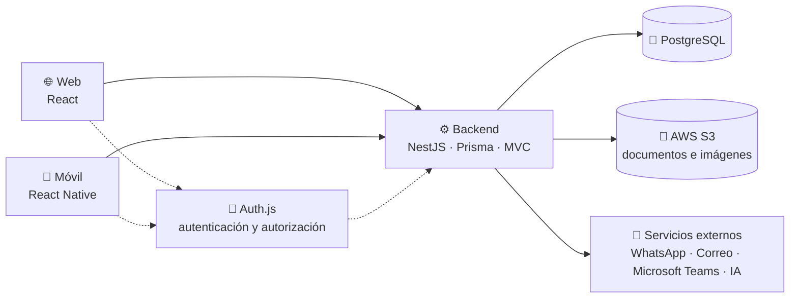

# Gestor de Semilleros Universitarios

**Plataforma integral para la gestión académica, administrativa y organizativa de los semilleros de investigación.**


> [!IMPORTANT]
> El proyecto está en **implementación inicial**. El backend incorpora autenticación, alta de usuarios por administradores, proyectos, tableros, actividades y novedades. La web tiene login y vistas compartidas por roles en desarrollo; no son cinco paneles terminados y existen cargas bloqueadas. Consultar el [relevo del frontend](docs/handoffs/2026-11-07-frontend.md) para conocer avances, defectos y pruebas. Móvil, documentos (S3), reuniones y otros módulos siguen pendientes. El workspace usa pnpm + Turborepo.

<a id="contenido"></a>

La recuperación de contraseña por correo está disponible desde «Olvidé mi contraseña»: código de 6 dígitos, 10 minutos y 5 intentos. Requiere SMTP y aplicar la migración `password_recovery`; ver [ADR 0016](docs/decisions/0016-recuperacion-de-contrasena.md).

## 📑 Contenido

- [Descripción](#descripcion)
- [Entregables](#entregables)
- [Arquitectura general](#arquitectura)
- [Características principales](#caracteristicas)
- [Tecnologías previstas](#tecnologias)
- [Estructura del proyecto](#estructura)
- [Requisitos previos](#requisitos)
- [Instalación y configuración](#instalacion)
- [Variables de entorno](#variables-entorno)
- [Ejecución del proyecto](#ejecucion)
- [Capturas de pantalla](#capturas)
- [Estado del proyecto](#estado)
- [Roadmap](#roadmap)
- [Contribuciones](#contribuciones)
- [Licencia](#licencia)

<a id="descripcion"></a>

## 🎯 Descripción

El **Gestor de Semilleros Universitarios** busca centralizar en una sola plataforma las actividades de los semilleros de investigación de una universidad. Hoy la información suele dispersarse entre hojas de cálculo, documentos aislados y canales de mensajería; este proyecto propone un espacio unificado para planificar reuniones, organizar documentación, asignar tareas y hacer seguimiento al progreso de cada semillero, integrante, tutor, facultad y decano.

La solución se plantea como un **monorepo en TypeScript** con **React** en la web, **React Native** en móvil y **NestJS** en el backend, usando **PostgreSQL** con **Prisma** como ORM y una arquitectura **MVC**. Los tres entregables comparten lenguaje, tipos y criterios de desarrollo.

<a id="entregables"></a>

## 🧩 Entregables

| Entregable | Tecnología | Responsabilidad principal |
| --- | --- | --- |
| 🌐 **Aplicación web** | React | Administración, gestión y consulta de la información. Paneles de control, tableros Kanban, seguimiento y reportes. |
| ⚙️ **Backend** | NestJS · Prisma · PostgreSQL · AWS S3 | Lógica de negocio, APIs, persistencia, almacenamiento de documentos e integración con servicios externos. |
| 📱 **Aplicación móvil** | React Native | Acceso a las funcionalidades de la plataforma desde dispositivos móviles, con notificaciones y consultas rápidas. |

<a id="arquitectura"></a>

## 🏗️ Arquitectura general

Vista conceptual de los entregables y los servicios que los rodean. El stack está definido; los detalles de infraestructura y del flujo de autenticación se concretarán durante el diseño.



- La **web (React)** y la **móvil (React Native)** consumen la API del backend; no acceden directamente a la base de datos ni a S3.
- **Auth.js** centraliza la autenticación. Ya funciona en el backend con sesión JWT en cookie (web); los roles globales se comprueban con `RolesGuard`. Los permisos por proyecto y el flujo en la aplicación móvil están pendientes.
- El **backend (NestJS)** aplica **MVC**: modelos y reglas de negocio en el dominio, controladores para la API y vistas en los clientes.
- **Prisma** es el ORM del backend y el único punto de acceso a **PostgreSQL**.
- **PostgreSQL** almacena los datos estructurados; **AWS S3** guarda documentos e imágenes.
- El despliegue se realiza con **Docker** ([ADR 0012](docs/decisions/0012-despliegue-con-contenedores.md)): `docker/compose.prod.yaml` levanta PostgreSQL, el backend y la web (nginx). Guías por modo en [`apps/backend/README.md`](apps/backend/README.md) y [`apps/web/README.md`](apps/web/README.md).

<a id="caracteristicas"></a>

## ✨ Características principales

> Funcionalidades planificadas. Hoy están disponibles, solo en el backend (API): el inicio de sesión (correo + contraseña y Google), `GET /api/me`, la creación de usuarios por el administrador, proyectos, tableros y actividades, las novedades y notificaciones con copias por correo y WhatsApp según las preferencias de cada usuario, y las reuniones agendadas en Microsoft Teams con recordatorios. El resto aún no está disponible.

**Gestión académica y operativa**

- 🗓️ **Reuniones:** agendamiento, registro, modificación y seguimiento.
- 📂 **Gestión documental:** digitalización, almacenamiento y organización de documentos.
- 📈 **Seguimiento personalizado:** progreso por semillero, integrante, tutor, facultad y decano.
- ✅ **Tareas:** creación, asignación y seguimiento mediante tableros Kanban.
- 🔄 **Control de tareas:** estados de *pendiente*, *en progreso*, *finalizado*, *cancelado*, *éxito* y *fracaso*, diferenciando **progreso** de **resultado**.
- 🔔 **Recordatorios:** creación, modificación y eliminación.

**Comunicación, integraciones y analítica**

- 💬 **Notificaciones:** envío mediante WhatsApp y correo electrónico.
- 🟣 **Microsoft Teams:** apoyo a la gestión y coordinación de reuniones.
- 🤖 **Inteligencia artificial:** generación de reportes, análisis de datos y seguimiento inteligente.
- 📊 **Panel de control:** indicadores, notificaciones, fechas importantes y progreso de los procesos.

<a id="tecnologias"></a>

## 🛠️ Tecnologías previstas

Solo se listan como definidas las decisiones ya tomadas. El resto permanece **por definir**.

| Área | Tecnología | Estado |
| --- | --- | --- |
| Lenguaje | TypeScript | ✅ Definido |
| Organización del código | Monorepo | ✅ Definido |
| Framework de la aplicación web | React | ✅ Definido |
| Framework de la aplicación móvil | React Native | ✅ Definido |
| Framework del backend | NestJS | ✅ Definido |
| Base de datos | PostgreSQL | ✅ Definido |
| ORM | Prisma | ✅ Definido |
| Documentos e imágenes | AWS S3 | ✅ Definido |
| Autenticación y autorización | Auth.js | ✅ Definido |
| Arquitectura | MVC | ✅ Definido |
| Despliegue | Docker | ✅ PostgreSQL local y despliegue completo con `docker/compose.prod.yaml` |
| Gestor de paquetes | pnpm | ✅ Definido |
| Herramientas del monorepo | Turborepo | ✅ Definido |
| Pruebas | Jest + Supertest | ✅ Definido e implementado en el backend |
| CI/CD | — | ⏳ Por definir |

<a id="estructura"></a>

## 📁 Estructura del proyecto

La estructura de carpetas está creada; solo el backend contiene código (`apps/web`, `apps/mobile` y `packages/` están vacíos). El backend se organiza como un **monolito modularizado** por dominios. El árbol completo y las convenciones están en [`docs/architecture/estructura.md`](docs/architecture/estructura.md).

```text
.
├── apps/
│   ├── backend/    # NestJS + Prisma (monolito modular)
│   ├── web/        # React
│   └── mobile/     # React Native
├── packages/       # types · validation · utils
├── docker/         # PostgreSQL local (compose.yaml) y despliegue (compose.prod.yaml)
├── docs/           # arquitectura · dominio · base de datos · API · ADRs
├── scripts/        # utilidades del monorepo
├── package.json    # workspace y scripts raíz
├── pnpm-workspace.yaml
└── turbo.json
```

<a id="requisitos"></a>

## 📋 Requisitos previos

| Requisito | Estado |
| --- | --- |
| Git | Recomendado |
| Node.js | Requerido · 24 LTS (`.nvmrc`) |
| PostgreSQL | 18.6 · se ejecuta en Docker, no requiere instalación local |
| pnpm | Requerido · 12.18.0, activado con Corepack (`corepack enable`) |
| Docker + Docker Compose | Requerido para la base de datos local y el despliegue |
| Editor con soporte para TypeScript | Recomendado |
| Acceso a AWS S3 | Requerido para la gestión documental |

Versiones registradas en [ADR 0001](docs/decisions/0001-modelo-de-datos-y-entorno-local.md). Prisma 7.10.1 se instala como dependencia del backend.

<a id="instalacion"></a>

## 🚀 Instalación y configuración

> El workspace usa **pnpm + Turborepo**. El backend está implementado y la aplicación web se está incorporando; la aplicación móvil sigue pendiente. Consultar la [guía web](apps/web/README.md) y la [guía del backend local](docs/database/local-setup.md).

1. **Clonar el repositorio** (URL pendiente de publicación).

   ```bash
   git clone <URL-del-repositorio>
   cd <nombre-del-repositorio>
   ```

2. **Instalar dependencias.**

   ```bash
   pnpm install
   ```

   Instala las dependencias de los paquetes del workspace. Si `pnpm` no está disponible, ejecuta antes `corepack enable`.

3. **Configurar las variables de entorno:** `cp apps/backend/.env.example apps/backend/.env`. Ver [Variables de entorno](#variables-entorno).

4. **Levantar la base de datos y aplicar las migraciones:** `pnpm db:up` y luego `pnpm db:migrate`. La guía completa está en [`docs/database/local-setup.md`](docs/database/local-setup.md). Para ejecutar cada aplicación en desarrollo, producción o con Docker, ver [`apps/backend/README.md`](apps/backend/README.md) y [`apps/web/README.md`](apps/web/README.md).

5. **Crear usuarios de desarrollo** (opcional): `SEED_PASSWORD='…' pnpm db:seed` crea un usuario por tipo con una contraseña común (en fish: anteponer `env`). Los usuarios sembrados son **solo para desarrollo**. Alternativa mínima: `admin:create` ([`docs/api/users.md`](docs/api/users.md#primer-administrador)).

6. **Iniciar el backend** según se describe en [Ejecución del proyecto](#ejecucion).

<a id="variables-entorno"></a>

## 🔐 Variables de entorno

Las variables se configuran por entorno y **nunca** se versionan. Las plantillas, con la explicación de cada variable, son:

- [`apps/backend/.env.example`](apps/backend/.env.example): `DATABASE_URL`, `PORT`, `AUTH_SECRET` (obligatoria, mínimo 32 caracteres), `AUTH_TRUST_HOST`, `AUTH_SESSION_MAX_AGE`, Google OAuth opcional (`AUTH_GOOGLE_ID`, `AUTH_GOOGLE_SECRET`), `TEST_DATABASE_URL`, `SEED_PASSWORD` (seed de desarrollo) y `ADMIN_*` (script `admin:create`).
- [`docker/.env.example`](docker/.env.example): `POSTGRES_*` del contenedor local (opcional).

Las copias de notificaciones por correo (SMTP) y WhatsApp (BuilderBot con el provider Baileys; se vincula escaneando un QR) se configuran con las variables `NOTIFICATIONS_*`, `SMTP_*`, `EMAIL_FROM` y `WHATSAPP_*` de `apps/backend/.env.example`; por defecto solo se registran en el log. Microsoft Teams usa `MICROSOFT_*` y `MEETINGS_TIME_ZONE` (requiere registrar una app en Entra ID; ver `docs/api/microsoft.md`). Las variables de AWS S3 e inteligencia artificial se añadirán cuando se integren esos servicios.

<a id="ejecucion"></a>

## ▶️ Ejecución del proyecto

El workspace usa **pnpm + Turborepo**. `pnpm dev` ejecuta los scripts de los paquetes implementados. El backend requiere su `.env` y PostgreSQL; la web usa un proxy local para `/api` y no necesita secretos en el navegador.

```bash
# Backend y web:
pnpm dev

# Solo la web, en http://127.0.0.1:5173:
pnpm --filter @gestor-semilleros/web dev
```

| Comando | Descripción |
| --- | --- |
| `pnpm install` | Instala las dependencias del workspace |
| `pnpm db:up` / `pnpm db:down` | Inicia o detiene PostgreSQL local (Docker) |
| `pnpm db:migrate` | Aplica las migraciones de Prisma y genera el cliente |
| `pnpm db:seed` | Siembra datos de **desarrollo** (usuarios, área, facultad y proyecto demo). Requiere `SEED_PASSWORD`; no corre en producción |
| `pnpm db:seed:bulk` | Miles de datos ficticios para probar la analítica (`SEED_BULK_SCALE`, `SEED_BULK_RESET=1`); ver [`docs/database/local-setup.md`](docs/database/local-setup.md#datos-masivos-para-la-analítica-seed-masiva) |
| `pnpm db:studio` | Abre Prisma Studio |
| `pnpm --filter @gestor-semilleros/backend admin:create` | Crea un administrador (`ADMIN_EMAIL`, `ADMIN_FULL_NAME`, `ADMIN_PASSWORD`) |
| `pnpm dev` | Inicia los entregables en modo desarrollo |
| `pnpm build` | Compila los entregables |
| `pnpm lint` | Tarea configurada; herramienta de linting pendiente |
| `pnpm test` | Ejecuta las pruebas unitarias |
| `pnpm test:e2e` | Ejecuta las pruebas de la API (requiere `pnpm db:up`) |
| `pnpm typecheck` | Verifica los tipos |

<a id="capturas"></a>

## 🖼️ Capturas de pantalla

Esta sección se completará con imágenes de la plataforma en funcionamiento.

| Vista | Entregable | Estado |
| --- | --- | --- |
| Panel de control | Aplicación web | ✅ Panel por rol (`GET /api/dashboard`) |
| Analítica | Aplicación web | ✅ Indicadores con filtros para administración, encargados de área y decanos (`GET /api/analytics`, [ADR 0016](docs/decisions/0016-modulo-de-analitica.md)) |
| Tablero Kanban de tareas | Aplicación web | ⏳ Pendiente |
| Seguimiento de semilleros | Aplicación web | ⏳ Pendiente |
| Consulta y notificaciones | Aplicación móvil | ⏳ Pendiente |

```markdown
<!-- Ejemplo de incorporación futura:

-->
```

<a id="estado"></a>

## 📌 Estado del proyecto

| Entregable | Estado | Notas |
| --- | --- | --- |
| Stack tecnológico | 🟢 Definido | React, React Native, NestJS, PostgreSQL, Prisma, AWS S3, Auth.js y Docker |
| Estructura del proyecto | 🟢 Definida | Monorepo con backend y primera entrega web; móvil pendiente |
| Herramientas del monorepo | 🟢 Definidas | pnpm + Turborepo |
| Aplicación web | 🟡 En implementación | React + Vite + Tailwind; login con correo y Google, paneles por rol, proyectos, tableros, reuniones, novedades y preferencias; selección de personas, áreas y facultades sin UUID |
| Backend | 🟡 En desarrollo | NestJS con inicio de sesión (Auth.js: correo + contraseña y Google), alta de usuarios por el administrador, proyectos, tableros y actividades con permisos por proyecto, novedades y notificaciones con copias por correo y WhatsApp, reuniones con Microsoft Teams, seed de desarrollo, esquema Prisma y pruebas |
| Aplicación móvil | 🟡 En planificación | Sin código fuente; autenticación móvil pendiente |
| Documentación | 🟡 En elaboración | Alcance, dominio y modelo de datos definidos |

> Versiones fijadas: Node.js 24 LTS, pnpm 12.18.0, Prisma 7.10.1 y PostgreSQL 18.6.

<a id="roadmap"></a>

## 🗺️ Roadmap

- [x] Definición del alcance y de los módulos funcionales
- [x] Selección del stack tecnológico
- [x] Selección de la base de datos y del ORM (PostgreSQL + Prisma)
- [x] Estructura base del monorepo y de los módulos del backend
- [x] Configuración del monorepo (pnpm + Turborepo)
- [x] Definición del modelo de datos y migraciones iniciales
- [x] Autenticación (Auth.js: correo + contraseña y Google) y alta de usuarios por el administrador
- [ ] Autenticación móvil y contratos de API de los demás módulos
- [x] Permisos por proyecto (proyectos, tableros y actividades)
- [ ] Resto de la gestión de usuarios
- [ ] CI/CD
- [x] Configuración de Docker para desarrollo y despliegue
- [ ] MVP del backend (módulos de dominio)
- [ ] MVP de la aplicación web
- [ ] MVP de la aplicación móvil
- [x] Copias de notificaciones por WhatsApp y correo electrónico
- [x] Integración con Microsoft Teams (reuniones)
- [x] Módulo de analítica con filtros (usuarios, tareas, reuniones, adjuntos)
- [ ] Módulo de inteligencia artificial y reportes
- [ ] Pruebas, documentación técnica y despliegue

<a id="contribuciones"></a>

## 🤝 Contribuciones

Las contribuciones serán bienvenidas cuando el repositorio entre en desarrollo. Mientras tanto:

1. Abre un *issue* para proponer mejoras o reportar problemas.
2. Si deseas contribuir con código, espera a que se publique la guía de contribución y la configuración del entorno.
3. Respeta las convenciones de estilo, los mensajes de commit y las revisiones por *pull request* que se definan.

La guía detallada (`CONTRIBUTING.md`) se añadirá junto con el código.

<a id="licencia"></a>

## 📄 Licencia

Licencia **por definir**. Hasta que se incluya un archivo `LICENSE`, el contenido de este repositorio no otorga permisos de uso, modificación ni distribución más allá de los establecidos por la legislación aplicable.

---

<div align="center">

**Gestor de Semilleros Universitarios** · Proyecto académico en desarrollo inicial

</div>
