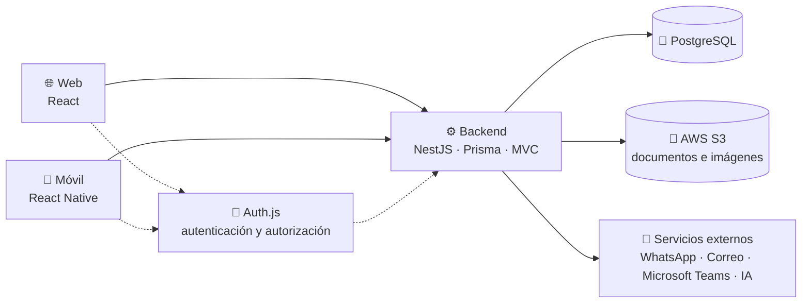

# Gestor de Semilleros Universitarios

**Plataforma integral para la gestión académica, administrativa y organizativa de los semilleros de investigación.**


> [!IMPORTANT]
> El proyecto se encuentra en **fase de planificación**. El stack, la estructura y el workspace (pnpm + Turborepo) ya están configurados, pero aún **no existe código fuente ni dependencias de aplicación instaladas**.

<a id="contenido"></a>

## 📑 Contenido

- [Descripción](#descripcion)
- [Entregables](#entregables)
- [Arquitectura general](#arquitectura)
- [Características principales](#caracteristicas)
- [Tecnologías previstas](#tecnologias)
- [Estructura del proyecto](#estructura)
- [Requisitos previos](#requisitos)
- [Instalación y configuración](#instalacion)
- [Variables de entorno](#variables-entorno)
- [Ejecución del proyecto](#ejecucion)
- [Capturas de pantalla](#capturas)
- [Estado del proyecto](#estado)
- [Roadmap](#roadmap)
- [Contribuciones](#contribuciones)
- [Licencia](#licencia)

<a id="descripcion"></a>

## 🎯 Descripción

El **Gestor de Semilleros Universitarios** busca centralizar en una sola plataforma las actividades de los semilleros de investigación de una universidad. Hoy la información suele dispersarse entre hojas de cálculo, documentos aislados y canales de mensajería; este proyecto propone un espacio unificado para planificar reuniones, organizar documentación, asignar tareas y hacer seguimiento al progreso de cada semillero, integrante, tutor, facultad y decano.

La solución se plantea como un **monorepo en TypeScript** con **React** en la web, **React Native** en móvil y **NestJS** en el backend, usando **PostgreSQL** con **Prisma** como ORM y una arquitectura **MVC**. Los tres entregables comparten lenguaje, tipos y criterios de desarrollo.

<a id="entregables"></a>

## 🧩 Entregables

| Entregable | Tecnología | Responsabilidad principal |
| --- | --- | --- |
| 🌐 **Aplicación web** | React | Administración, gestión y consulta de la información. Paneles de control, tableros Kanban, seguimiento y reportes. |
| ⚙️ **Backend** | NestJS · Prisma · PostgreSQL · AWS S3 | Lógica de negocio, APIs, persistencia, almacenamiento de documentos e integración con servicios externos. |
| 📱 **Aplicación móvil** | React Native | Acceso a las funcionalidades de la plataforma desde dispositivos móviles, con notificaciones y consultas rápidas. |

<a id="arquitectura"></a>

## 🏗️ Arquitectura general

Vista conceptual de los entregables y los servicios que los rodean. El stack está definido; los detalles de infraestructura y del flujo de autenticación se concretarán durante el diseño.



- La **web (React)** y la **móvil (React Native)** consumen la API del backend; no acceden directamente a la base de datos ni a S3.
- **Auth.js** centraliza la autenticación y autorización. El detalle de sesiones, roles y del flujo en la aplicación móvil está pendiente de definición.
- El **backend (NestJS)** aplica **MVC**: modelos y reglas de negocio en el dominio, controladores para la API y vistas en los clientes.
- **Prisma** es el ORM del backend y el único punto de acceso a **PostgreSQL**.
- **PostgreSQL** almacena los datos estructurados; **AWS S3** guarda documentos e imágenes.
- El despliegue se realizará con **Docker**. Los Dockerfiles y la configuración de contenedores aún no existen.

<a id="caracteristicas"></a>

## ✨ Características principales

> Funcionalidades planificadas. Ninguna se encuentra disponible todavía.

**Gestión académica y operativa**

- 🗓️ **Reuniones:** agendamiento, registro, modificación y seguimiento.
- 📂 **Gestión documental:** digitalización, almacenamiento y organización de documentos.
- 📈 **Seguimiento personalizado:** progreso por semillero, integrante, tutor, facultad y decano.
- ✅ **Tareas:** creación, asignación y seguimiento mediante tableros Kanban.
- 🔄 **Control de tareas:** estados de *pendiente*, *en progreso*, *finalizado*, *cancelado*, *éxito* y *fracaso*, diferenciando **progreso** de **resultado**.
- 🔔 **Recordatorios:** creación, modificación y eliminación.

**Comunicación, integraciones y analítica**

- 💬 **Notificaciones:** envío mediante WhatsApp y correo electrónico.
- 🟣 **Microsoft Teams:** apoyo a la gestión y coordinación de reuniones.
- 🤖 **Inteligencia artificial:** generación de reportes, análisis de datos y seguimiento inteligente.
- 📊 **Panel de control:** indicadores, notificaciones, fechas importantes y progreso de los procesos.

<a id="tecnologias"></a>

## 🛠️ Tecnologías previstas

Solo se listan como definidas las decisiones ya tomadas. El resto permanece **por definir**.

| Área | Tecnología | Estado |
| --- | --- | --- |
| Lenguaje | TypeScript | ✅ Definido |
| Organización del código | Monorepo | ✅ Definido |
| Framework de la aplicación web | React | ✅ Definido |
| Framework de la aplicación móvil | React Native | ✅ Definido |
| Framework del backend | NestJS | ✅ Definido |
| Base de datos | PostgreSQL | ✅ Definido |
| ORM | Prisma | ✅ Definido |
| Documentos e imágenes | AWS S3 | ✅ Definido |
| Autenticación y autorización | Auth.js | ✅ Definido |
| Arquitectura | MVC | ✅ Definido |
| Despliegue | Docker | ✅ Definido |
| Gestor de paquetes | pnpm | ✅ Definido |
| Herramientas del monorepo | Turborepo | ✅ Definido |
| Pruebas y CI/CD | — | ⏳ Por definir |

<a id="estructura"></a>

## 📁 Estructura del proyecto

La estructura inicial de carpetas ya está creada (todavía sin código). El backend se organiza como un **monolito modularizado** por dominios. El árbol completo y las convenciones están en [`docs/architecture/estructura.md`](docs/architecture/estructura.md).

```text
.
├── apps/
│   ├── backend/    # NestJS + Prisma (monolito modular)
│   ├── web/        # React
│   └── mobile/     # React Native
├── packages/       # types · validation · utils
├── docker/         # configuración de contenedores
├── docs/           # arquitectura · API · ADRs
├── scripts/        # utilidades del monorepo
├── package.json    # workspace y scripts raíz
├── pnpm-workspace.yaml
└── turbo.json
```

<a id="requisitos"></a>

## 📋 Requisitos previos

| Requisito | Estado |
| --- | --- |
| Git | Recomendado |
| Node.js | Requerido (versión por definir) |
| PostgreSQL | Requerido (versión por definir) |
| pnpm | Requerido (versión por definir) |
| Docker | Requerido para el despliegue |
| Editor con soporte para TypeScript | Recomendado |
| Acceso a AWS S3 | Requerido para la gestión documental |

Las versiones mínimas de Node.js, pnpm, PostgreSQL y Prisma se documentarán al iniciar la implementación.

<a id="instalacion"></a>

## 🚀 Instalación y configuración

> El workspace ya está configurado con **pnpm + Turborepo**, pero las aplicaciones aún no existen. Los pasos marcados como pendientes se completarán al implementarlas.

1. **Clonar el repositorio** (URL pendiente de publicación).

   ```bash
   git clone <URL-del-repositorio>
   cd <nombre-del-repositorio>
   ```

2. **Instalar dependencias.**

   ```bash
   pnpm install
   ```

   Instala las dependencias del workspace y Turborepo. Todavía no hay dependencias de aplicación declaradas.

3. **Configurar las variables de entorno** a partir de la plantilla que se publicará con el proyecto. Ver [Variables de entorno](#variables-entorno).

4. **Preparar el entorno de contenedores** (pendiente: los Dockerfiles y la configuración de Docker aún no existen).

5. **Iniciar los entregables** según se describe en [Ejecución del proyecto](#ejecucion).

<a id="variables-entorno"></a>

## 🔐 Variables de entorno

Aún no se han definido las variables requeridas. La plantilla se incorporará cuando exista el backend y se conozcan los servicios externos efectivamente integrados.

```env
# Pendiente de definición.
#
# Aquí se documentarán las variables necesarias para, entre otras:
#   - conexión con PostgreSQL (gestionada mediante Prisma)
#   - credenciales y configuración de AWS S3 (documentos e imágenes)
#   - secretos de Auth.js para sesiones y autenticación
#   - envío de notificaciones por WhatsApp y correo electrónico
#   - integración con Microsoft Teams
#   - servicios de inteligencia artificial
#
# Ninguna credencial debe versionarse en el repositorio.
```

<a id="ejecucion"></a>

## ▶️ Ejecución del proyecto

El workspace usa **pnpm + Turborepo**. Todavía no hay aplicaciones ni scripts de arranque; cuando existan, `pnpm dev` ejecutará el entorno de desarrollo de cada entregable.

```bash
# Arranque previsto del workspace (aún sin aplicaciones):
pnpm dev
#
# Cada entregable definirá su propio script "dev":
#   - aplicación web (React)
#   - backend (NestJS)
#   - aplicación móvil (React Native)
#
# Docker se añadirá al configurar el despliegue.
```

| Comando | Descripción |
| --- | --- |
| `pnpm install` | Instala las dependencias del workspace |
| `pnpm dev` | Inicia los entregables en modo desarrollo |
| `pnpm build` | Compila los entregables |
| `pnpm lint` | Ejecuta el análisis estático |
| `pnpm test` | Ejecuta las pruebas |
| `pnpm typecheck` | Verifica los tipos |

<a id="capturas"></a>

## 🖼️ Capturas de pantalla

Esta sección se completará con imágenes de la plataforma en funcionamiento.

| Vista | Entregable | Estado |
| --- | --- | --- |
| Panel de control | Aplicación web | ⏳ Pendiente |
| Tablero Kanban de tareas | Aplicación web | ⏳ Pendiente |
| Seguimiento de semilleros | Aplicación web | ⏳ Pendiente |
| Consulta y notificaciones | Aplicación móvil | ⏳ Pendiente |

```markdown
<!-- Ejemplo de incorporación futura:

-->
```

<a id="estado"></a>

## 📌 Estado del proyecto

| Entregable | Estado | Notas |
| --- | --- | --- |
| Stack tecnológico | 🟢 Definido | React, React Native, NestJS, PostgreSQL, Prisma, AWS S3, Auth.js y Docker |
| Estructura del proyecto | 🟢 Definida | Carpetas base del monorepo, sin código |
| Herramientas del monorepo | 🟢 Definidas | pnpm + Turborepo |
| Aplicación web | 🟡 En planificación | Sin código fuente |
| Backend | 🟡 En planificación | Sin código fuente |
| Aplicación móvil | 🟡 En planificación | Sin código fuente |
| Documentación | 🟡 En elaboración | Alcance funcional y stack definidos |

> Las versiones de Node.js, pnpm, PostgreSQL y Prisma aún no están fijadas.

<a id="roadmap"></a>

## 🗺️ Roadmap

- [x] Definición del alcance y de los módulos funcionales
- [x] Selección del stack tecnológico
- [x] Selección de la base de datos y del ORM (PostgreSQL + Prisma)
- [x] Estructura base del monorepo y de los módulos del backend
- [x] Configuración del monorepo (pnpm + Turborepo)
- [ ] Definición del modelo de datos y migraciones iniciales
- [ ] Definición de los contratos de la API y del flujo de autenticación
- [ ] Configuración de Docker para desarrollo y despliegue
- [ ] MVP del backend
- [ ] MVP de la aplicación web
- [ ] MVP de la aplicación móvil
- [ ] Integraciones con WhatsApp, correo electrónico y Microsoft Teams
- [ ] Módulo de inteligencia artificial y reportes
- [ ] Pruebas, documentación técnica y despliegue

<a id="contribuciones"></a>

## 🤝 Contribuciones

Las contribuciones serán bienvenidas cuando el repositorio entre en desarrollo. Mientras tanto:

1. Abre un *issue* para proponer mejoras o reportar problemas.
2. Si deseas contribuir con código, espera a que se publique la guía de contribución y la configuración del entorno.
3. Respeta las convenciones de estilo, los mensajes de commit y las revisiones por *pull request* que se definan.

La guía detallada (`CONTRIBUTING.md`) se añadirá junto con el código.

<a id="licencia"></a>

## 📄 Licencia

Licencia **por definir**. Hasta que se incluya un archivo `LICENSE`, el contenido de este repositorio no otorga permisos de uso, modificación ni distribución más allá de los establecidos por la legislación aplicable.

---

<div align="center">

**Gestor de Semilleros Universitarios** · Proyecto académico en fase de planificación

</div>
