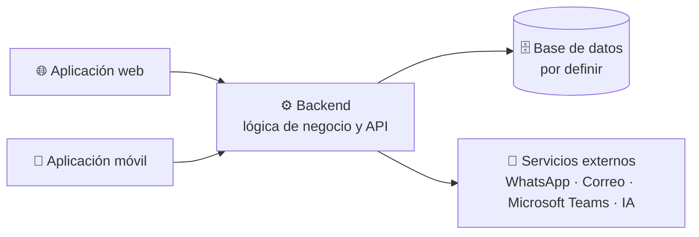

# Gestor de Semilleros Universitarios

**Plataforma integral para la gestión académica, administrativa y organizativa de los semilleros de investigación.**


> [!IMPORTANT]
> El proyecto se encuentra en **fase de planificación**. Aún no existe código fuente implementado: las tecnologías, la estructura y los comandos descritos como *pendientes* se definirán en las siguientes etapas.

<a id="contenido"></a>

## 📑 Contenido

- [Descripción](#descripcion)
- [Entregables](#entregables)
- [Arquitectura general](#arquitectura)
- [Características principales](#caracteristicas)
- [Tecnologías previstas](#tecnologias)
- [Estructura del proyecto](#estructura)
- [Requisitos previos](#requisitos)
- [Instalación y configuración](#instalacion)
- [Variables de entorno](#variables-entorno)
- [Ejecución del proyecto](#ejecucion)
- [Capturas de pantalla](#capturas)
- [Estado del proyecto](#estado)
- [Roadmap](#roadmap)
- [Contribuciones](#contribuciones)
- [Licencia](#licencia)

<a id="descripcion"></a>

## 🎯 Descripción

El **Gestor de Semilleros Universitarios** busca centralizar en una sola plataforma las actividades de los semilleros de investigación de una universidad. Hoy la información suele dispersarse entre hojas de cálculo, documentos aislados y canales de mensajería; este proyecto propone un espacio unificado para planificar reuniones, organizar documentación, asignar tareas y hacer seguimiento al progreso de cada semillero, integrante, tutor, facultad y decano.

La solución se plantea como un **monorepo en TypeScript** compuesto por tres entregables que comparten lenguaje y criterios de desarrollo.

<a id="entregables"></a>

## 🧩 Entregables

| Entregable | Responsabilidad principal |
| --- | --- |
| 🌐 **Aplicación web** | Administración, gestión y consulta de la información. Paneles de control, tableros Kanban, seguimiento y reportes. |
| ⚙️ **Backend** | Lógica de negocio, APIs, procesamiento de información y comunicación con servicios externos. |
| 📱 **Aplicación móvil** | Acceso a las funcionalidades de la plataforma desde dispositivos móviles, con notificaciones y consultas rápidas. |

<a id="arquitectura"></a>

## 🏗️ Arquitectura general

Vista conceptual de la relación entre los entregables y los servicios externos previstos. Los detalles de infraestructura y protocolos están **pendientes de definición**.



- Las aplicaciones **web** y **móvil** consumen la API expuesta por el backend.
- El **backend** concentra la lógica de negocio, la persistencia y la integración con servicios externos.
- La **base de datos** y los mecanismos de autenticación se definirán junto con el stack tecnológico.

<a id="caracteristicas"></a>

## ✨ Características principales

> Funcionalidades planificadas. Ninguna se encuentra disponible todavía.

**Gestión académica y operativa**

- 🗓️ **Reuniones:** agendamiento, registro, modificación y seguimiento.
- 📂 **Gestión documental:** digitalización, almacenamiento y organización de documentos.
- 📈 **Seguimiento personalizado:** progreso por semillero, integrante, tutor, facultad y decano.
- ✅ **Tareas:** creación, asignación y seguimiento mediante tableros Kanban.
- 🔄 **Control de tareas:** estados de *pendiente*, *en progreso*, *finalizado*, *cancelado*, *éxito* y *fracaso*, diferenciando **progreso** de **resultado**.
- 🔔 **Recordatorios:** creación, modificación y eliminación.

**Comunicación, integraciones y analítica**

- 💬 **Notificaciones:** envío mediante WhatsApp y correo electrónico.
- 🟣 **Microsoft Teams:** apoyo a la gestión y coordinación de reuniones.
- 🤖 **Inteligencia artificial:** generación de reportes, análisis de datos y seguimiento inteligente.
- 📊 **Panel de control:** indicadores, notificaciones, fechas importantes y progreso de los procesos.

<a id="tecnologias"></a>

## 🛠️ Tecnologías previstas

Solo se listan como definidas las decisiones ya tomadas. El resto permanece **por definir**.

| Área | Tecnología | Estado |
| --- | --- | --- |
| Lenguaje | TypeScript | ✅ Definido |
| Organización del código | Monorepo | ✅ Definido |
| Framework de la aplicación web | — | ⏳ Por definir |
| Framework de la aplicación móvil | — | ⏳ Por definir |
| Framework del backend | — | ⏳ Por definir |
| Base de datos | — | ⏳ Por definir |
| Autenticación y autorización | — | ⏳ Por definir |
| Herramientas del monorepo | — | ⏳ Por definir |
| Pruebas y CI/CD | — | ⏳ Por definir |

<a id="estructura"></a>

## 📁 Estructura del proyecto

La siguiente es una **estructura propuesta**, no una estructura existente. Se ajustará cuando se seleccionen las herramientas del monorepo.

```text
.
├── apps/
│   ├── web/        # Aplicación web
│   ├── mobile/     # Aplicación móvil
│   └── backend/    # API y lógica de negocio
├── packages/       # Código compartido (tipos, validaciones, utilidades)
└── docs/           # Documentación del proyecto
```

<a id="requisitos"></a>

## 📋 Requisitos previos

| Requisito | Estado |
| --- | --- |
| Git | Recomendado |
| Runtime de JavaScript/TypeScript | ⏳ Por definir |
| Gestor de paquetes | ⏳ Por definir |
| Editor con soporte para TypeScript | Recomendado |

Las versiones mínimas se documentarán una vez definido el stack tecnológico.

<a id="instalacion"></a>

## 🚀 Instalación y configuración

> Los pasos siguientes quedan **preparados para completarse** cuando exista el código. Los comandos aún no pueden ejecutarse.

1. **Clonar el repositorio** (URL pendiente de publicación).

   ```bash
   git clone <URL-del-repositorio>
   cd <nombre-del-repositorio>
   ```

2. **Instalar dependencias.**

   ```bash
   # Pendiente de definición: dependerá del gestor de paquetes
   # y de la herramienta de monorepo seleccionados.
   ```

3. **Configurar las variables de entorno** a partir de la plantilla que se publicará con el proyecto. Ver [Variables de entorno](#variables-entorno).

4. **Iniciar los entregables** según se describe en [Ejecución del proyecto](#ejecucion).

<a id="variables-entorno"></a>

## 🔐 Variables de entorno

Aún no se han definido las variables requeridas. La plantilla se incorporará cuando exista el backend y se conozcan los servicios externos efectivamente integrados.

```env
# Pendiente de definición.
#
# Aquí se documentarán las variables necesarias para, entre otras:
#   - conexión con la base de datos
#   - autenticación y autorización
#   - envío de notificaciones por WhatsApp y correo electrónico
#   - integración con Microsoft Teams
#   - servicios de inteligencia artificial
#
# Ninguna credencial debe versionarse en el repositorio.
```

<a id="ejecucion"></a>

## ▶️ Ejecución del proyecto

Los comandos de ejecución se definirán junto con la estructura del monorepo y los frameworks elegidos.

```bash
# Pendiente de definición.
#
# Se documentará cómo iniciar cada entregable:
#   - aplicación web
#   - backend
#   - aplicación móvil
```

<a id="capturas"></a>

## 🖼️ Capturas de pantalla

Esta sección se completará con imágenes de la plataforma en funcionamiento.

| Vista | Entregable | Estado |
| --- | --- | --- |
| Panel de control | Aplicación web | ⏳ Pendiente |
| Tablero Kanban de tareas | Aplicación web | ⏳ Pendiente |
| Seguimiento de semilleros | Aplicación web | ⏳ Pendiente |
| Consulta y notificaciones | Aplicación móvil | ⏳ Pendiente |

```markdown
<!-- Ejemplo de incorporación futura:

-->
```

<a id="estado"></a>

## 📌 Estado del proyecto

| Entregable | Estado | Notas |
| --- | --- | --- |
| Aplicación web | 🟡 En planificación | Sin código fuente |
| Backend | 🟡 En planificación | Sin código fuente |
| Aplicación móvil | 🟡 En planificación | Sin código fuente |
| Documentación | 🟡 En elaboración | Alcance funcional definido |

<a id="roadmap"></a>

## 🗺️ Roadmap

- [x] Definición del alcance y de los módulos funcionales
- [ ] Selección del stack tecnológico
- [ ] Definición de la arquitectura de datos y de la API
- [ ] Configuración del monorepo
- [ ] MVP del backend
- [ ] MVP de la aplicación web
- [ ] MVP de la aplicación móvil
- [ ] Integraciones con WhatsApp, correo electrónico y Microsoft Teams
- [ ] Módulo de inteligencia artificial y reportes
- [ ] Pruebas, documentación técnica y despliegue

<a id="contribuciones"></a>

## 🤝 Contribuciones

Las contribuciones serán bienvenidas cuando el repositorio entre en desarrollo. Mientras tanto:

1. Abre un *issue* para proponer mejoras o reportar problemas.
2. Si deseas contribuir con código, espera a que se publique la guía de contribución y la configuración del entorno.
3. Respeta las convenciones de estilo, los mensajes de commit y las revisiones por *pull request* que se definan.

La guía detallada (`CONTRIBUTING.md`) se añadirá junto con el código.

<a id="licencia"></a>

## 📄 Licencia

Licencia **por definir**. Hasta que se incluya un archivo `LICENSE`, el contenido de este repositorio no otorga permisos de uso, modificación ni distribución más allá de los establecidos por la legislación aplicable.

---

<div align="center">

**Gestor de Semilleros Universitarios** · Proyecto académico en fase de planificación

</div>
