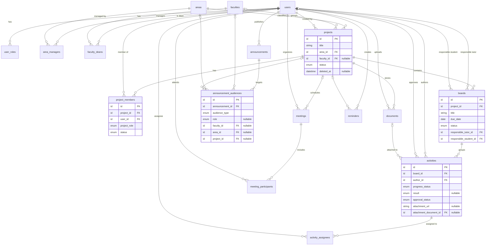

# Modelo de datos (propuesta conceptual)

> **Estado:** propuesta **pendiente de aprobación**. No existe `schema.prisma` ni migraciones. Este documento **no** las sustituye ni autoriza a crearlas (ver [`AGENTS.md`](../../AGENTS.md) §12).
> Se basa en [`docs/domain/entities.md`](../domain/entities.md). Si hay discrepancias, manda el dominio.
> Las decisiones `DB-xx` están en [`database-decisions.md`](database-decisions.md) y las preguntas `P-xx`, en [`business-rules.md`](../domain/business-rules.md#preguntas-pendientes).

## 1. Convenciones propuestas

- Los nombres de tablas y columnas van en **inglés** (`AGENTS.md` §7). La correspondencia con los términos en español está en §2.
- Cada tabla tiene una clave primaria propia `id`, cuyo tipo está pendiente (DB-14). Las tablas asociativas puras usan una clave compuesta.
- Las tablas de negocio tienen `created_at` y `updated_at`. Las que admiten eliminación lógica tienen además `deleted_at` (DB-10).
- Los conjuntos cerrados de valores son **enumeraciones**. Sus valores son provisionales mientras no se confirmen (P-11, P-12, P-26).

## 2. Correspondencia dominio → tablas

| Concepto (es) | Tabla propuesta | Tipo |
| --- | --- | --- |
| Usuario | `users` | Entidad |
| Asignación de rol global | `user_roles` | Asociativa (DB-01) |
| Área | `areas` | Entidad |
| Encargado de área | `area_managers` | Asociativa |
| Facultad | `faculties` | Entidad |
| Asignación de decano | `faculty_deans` | Asociativa con vigencia (DB-03) |
| Proyecto | `projects` | Entidad |
| Participante de proyecto | `project_members` | Asociativa con atributos (DB-02) |
| Tablero | `boards` | Entidad |
| Actividad | `activities` | Entidad |
| Encargado de actividad | `activity_assignees` | Asociativa |
| Documento | `documents` | Entidad |
| Novedad | `announcements` | Entidad |
| Audiencia de novedad | `announcement_audiences` | Asociativa con discriminador (DB-06) |
| Reunión | `meetings` | Entidad |
| Participante de reunión | `meeting_participants` | Asociativa |
| Recordatorio | `reminders` | Entidad (❓ P-19) |

## 3. Tablas

`PK` clave primaria · `FK` clave foránea · `UQ` única · `NN` no nula · `?` opcional.

### Usuarios y roles

**`users`**: `id` PK · `full_name` NN · `email` NN UQ · `status` NN (`ACTIVE`/`INACTIVE`) · timestamps.

**`user_roles`**: (`user_id` FK→users, `role` enum) PK.
`role` ∈ `ADMIN`, `AREA_MANAGER`, `DEAN`, `TUTOR`, `STUDENT`. Si se confirma un único rol por usuario (P-02), esta tabla se reduce a una columna `users.role`.

### Estructura institucional

**`areas`**: `id` PK · `name` NN UQ · `description?` · timestamps.

**`area_managers`**: (`area_id` FK, `user_id` FK) PK · `assigned_at` NN. Su existencia depende de P-08.

**`faculties`**: `id` PK · `name` NN UQ · timestamps. El código institucional queda ❓.

**`faculty_deans`**: `id` PK · `faculty_id` FK NN · `user_id` FK NN · `starts_at` NN · `ends_at?`.
Restricción: como máximo **un decano vigente por facultad** (`ends_at IS NULL`), mediante un índice único parcial (ver §6).

### Proyectos

**`projects`**: `id` PK · `title` NN · `description?` · `area_id` FK NN · `faculty_id` FK? (P-04) · `status` NN (❓ P-26) · `starts_on?` · `ends_on?` · `created_by_id` FK→users · `deleted_at?` · timestamps.

**`project_members`**: `id` PK · `project_id` FK NN · `user_id` FK NN · `project_role` NN (`TUTOR`, `STUDENT`, `STUDENT_LEADER`; P-03) · `status` NN (`ACTIVE`/`INACTIVE`) · `joined_at` NN · `left_at?`.
Restricción: un único registro **activo** por (`project_id`, `user_id`). Si no hace falta historial (P-25), basta un `UQ(project_id, user_id)`.
No incluye al decano, cuyo vínculo se deriva de `projects.faculty_id` → `faculty_deans` (DB-04).

### Tableros y actividades

**`boards`**: `id` PK · `project_id` FK NN · `title` NN · `due_date` NN · `status` NN (❓ P-11) · `responsible_tutor_id` FK→users NN · `responsible_student_id` FK→users NN · `deleted_at?` · timestamps.
Validación: los dos responsables deben ser `project_members` activos del mismo proyecto y con el rol correspondiente (DB-05).

**`activities`**: `id` PK · `board_id` FK NN · `author_id` FK→users NN · `title` NN · `description?` · `progress_status` NN · `result?` · `approval_status` NN · `approved_by_id?` FK→users · `approved_at?` · `attachment_url?` · `attachment_document_id?` FK→documents · `deleted_at?` · timestamps.
- `progress_status` ∈ `PENDING`, `IN_PROGRESS`, `DONE`, `CANCELLED` (RN-03). `result` ∈ `SUCCESS`, `FAILURE` (RN-03) (DB-09).
- `approval_status` ∈ `PENDING`, `APPROVED`, `REJECTED` (❓ P-12).
- CHECK: `attachment_url` y `attachment_document_id` no pueden tener valor a la vez (DB-07).
- No guarda `project_id`; se obtiene a través de `board_id` (3FN).

**`activity_assignees`**: (`activity_id` FK, `user_id` FK) PK · `assigned_by_id` FK→users · `assigned_at` NN. Si se confirma un único encargado (P-10), pasa a ser la columna `activities.assignee_id`.

### Documentos

**`documents`**: `id` PK · `project_id` FK NN (🟡 P-15) · `uploaded_by_id` FK→users NN · `file_name` NN · `format` NN (`PDF`, `WORD`, `EXCEL`, `IMAGE`) · `mime_type` NN · `size_bytes` NN · `storage_key` NN UQ · `created_at` · `deleted_at?`.
El enlace de descarga se genera a partir de `storage_key` (DB-08).

### Novedades

**`announcements`**: `id` PK · `author_id` FK→users NN · `title` NN · `content` NN · `kind?` (❓) · `published_at` NN · `expires_at?` (❓ P-16) · timestamps.

**`announcement_audiences`**: `id` PK · `announcement_id` FK NN · `audience_type` NN (`ALL`, `ROLE`, `FACULTY`, `AREA`, `PROJECT`) · `role?` · `faculty_id?` FK · `area_id?` FK · `project_id?` FK.
CHECK: solo la columna de destino que corresponde a `audience_type` tiene valor, y ninguna si es `ALL` (DB-06).

### Reuniones y recordatorios

**`meetings`**: `id` PK · `project_id?` FK (P-18) · `organizer_id` FK→users NN · `external_id` UQ? (Teams) · `reason` NN · `starts_at` NN · `duration_minutes` NN (> 0) · `join_url?` · `recording_url?` · timestamps.

**`meeting_participants`**: (`meeting_id` FK, `user_id` FK) PK.

**`reminders`** (❓ P-19, propuesta mínima): `id` PK · `created_by_id` FK NN · `project_id?` FK · `title` NN · `remind_at` NN · timestamps.

## 4. Diagrama relacional

## 5. Normalización

| Forma | Cómo se cumple |
| --- | --- |
| **1FN** | No hay atributos multivaluados. Roles, participantes, encargados, audiencias y asistentes van en tablas propias y no en listas o arreglos. |
| **2FN** | En las tablas con clave compuesta (`user_roles`, `area_managers`, `activity_assignees`, `meeting_participants`), los atributos dependen de la clave completa (p. ej. `assigned_at` describe la asignación, no solo al usuario). |
| **3FN** | No hay dependencias transitivas. El decano de un proyecto **no** se guarda en `projects` (se deriva de la facultad), la facultad no se repite en `boards` ni en `activities`, y las métricas no se persisten. |

**Decisiones de no normalizar más** (para no forzar entidades innecesarias):

- Los roles y estados son **enumeraciones**, no tablas catálogo, porque son conjuntos pequeños y estables. Si la institución necesita administrarlos, se reevalúa.
- El **adjunto** de actividad son dos columnas opcionales, no una tabla, porque la cardinalidad confirmada es 0..1 (DB-07).
- La reunión guarda `duration_minutes` y no `ends_at`. Guardar ambas sería redundante (DB-12).
- `boards.project_id` sí se guarda, porque es la relación de pertenencia. `activities` llega al proyecto a través del tablero.

## 6. Integridad referencial y restricciones

| Restricción | Mecanismo |
| --- | --- |
| Pertenencias obligatorias (tablero → proyecto, actividad → tablero) | FK NN |
| Un decano vigente por facultad | Índice único parcial `faculty_deans(faculty_id) WHERE ends_at IS NULL` |
| Un participante activo por usuario y proyecto | Índice único parcial o `UQ` simple (P-25) |
| Adjunto exclusivo (enlace o documento) | CHECK |
| Audiencia coherente con su tipo | CHECK |
| Duración positiva | CHECK |
| Responsables y encargados son participantes del proyecto | Validación en el servicio (DB-05) |
| Política de borrado | `RESTRICT` por defecto y eliminación lógica en entidades de negocio (DB-10) |

## 7. Consideraciones para Prisma ORM

Son puntos a tener en cuenta al redactar `schema.prisma`, **sin crearlo todavía**:

1. **N:M explícitas:** todas las relaciones N:M tienen atributos o pueden llegar a tenerlos. Conviene modelarlas como **modelos explícitos** y no como relaciones implícitas de Prisma.
2. **Varias relaciones al mismo modelo:** `boards` (dos usuarios), `activities` (autor y aprobador) y `projects` (creador) necesitan **nombres de relación** que las distingan.
3. **Restricciones no expresables en el esquema:** los CHECK y los índices únicos parciales no se declaran en `schema.prisma`. Requieren **SQL personalizado en la migración**. Esto queda pendiente de aprobación y debe documentarse cuando se haga.
4. **Polimorfismo:** Prisma no tiene relaciones polimórficas. Este es otro motivo para elegir columnas FK opcionales en `announcement_audiences` (DB-06).
5. **Enumeraciones:** se usan `enum` de Prisma, que en PostgreSQL son tipos enumerados. Cambiar sus valores requiere migración, por eso deben confirmarse antes (P-11, P-12, P-26).
6. **Eliminación lógica:** Prisma no la aplica automáticamente. Se necesitaría un filtro central en `PrismaService` o una extensión del cliente (decisión técnica pendiente).
7. **`onDelete`:** hay que definirlo de forma explícita en cada relación. La propuesta es `Restrict` en entidades de negocio y `Cascade` solo en asociativas puras (p. ej. `meeting_participants` al borrar físicamente una reunión).
8. **Mapeo de nombres:** los modelos en PascalCase (`ProjectMember`) se mapean a tablas en snake_case (`project_members`) con `@@map`/`@map`, si se aprueba esa convención (DB-13).
9. **Auth.js:** si se usa su adaptador de Prisma, este exige modelos propios (cuentas, sesiones, tokens) que deben convivir con `users`. Depende del flujo de autenticación, que está pendiente (`AGENTS.md` §4).
10. **Identificadores:** el tipo de `id` está pendiente: UUID, CUID o autoincremental (DB-14).
11. **Índices:** se recomiendan índices sobre las FK más consultadas (`project_members.user_id`, `activities.board_id`, `announcement_audiences.*_id`) y sobre `deleted_at` si se aplica eliminación lógica.
