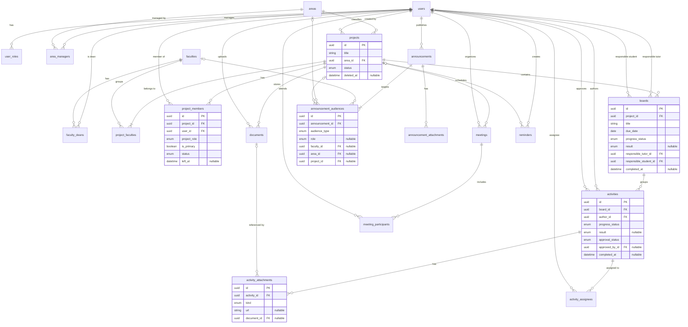

# Modelo de datos

> **Estado:** implementado en [`apps/backend/prisma/schema.prisma`](../../apps/backend/prisma/schema.prisma) con una migración inicial (`apps/backend/prisma/migrations/`). **El esquema es la fuente de verdad técnica**: si este documento y el esquema difieren, manda el esquema y debe corregirse el documento.
> Se basa en [`docs/domain/entities.md`](../domain/entities.md). Si hay discrepancias con el dominio, manda el dominio.
> Las decisiones `DB-xx` están en [`database-decisions.md`](database-decisions.md), las preguntas `P-xx`, en [`business-rules.md`](../domain/business-rules.md#preguntas-pendientes), y la decisión de registro, en [`docs/decisions/0001-modelo-de-datos-y-entorno-local.md`](../decisions/0001-modelo-de-datos-y-entorno-local.md).
> Instalación y base de datos local: [`local-setup.md`](local-setup.md).
> Siguen provisionales `area_managers` (P-08) y `reminders` (P-19).

## 1. Convenciones

- Los nombres de tablas y columnas van en **inglés** (`AGENTS.md` §7). La correspondencia con los términos en español está en §2.
- Cada tabla de entidad tiene una clave primaria `id` de tipo **UUID** (`@db.Uuid`, `@default(uuid())`; DB-14). Las tablas asociativas puras usan una clave compuesta.
- Modelos en PascalCase y tablas/columnas en snake_case mediante `@@map`/`@map` (DB-13).
- Las tablas de negocio tienen `created_at` y `updated_at` (salvo las excepciones indicadas en §3). Las que admiten eliminación lógica tienen `deleted_at` (DB-10): `projects`, `boards`, `activities`, `documents`, `announcements` y `meetings`.
- Los conjuntos cerrados de valores son **enumeraciones** de Prisma.

## 2. Correspondencia dominio → tablas

| Concepto (es) | Tabla | Tipo |
| --- | --- | --- |
| Usuario | `users` | Entidad |
| Asignación de rol global | `user_roles` | Asociativa (DB-01) |
| Área | `areas` | Entidad |
| Encargado de área | `area_managers` | Asociativa (provisional, P-08) |
| Facultad | `faculties` | Entidad |
| Asignación de decano | `faculty_deans` | Asociativa con vigencia (DB-03) |
| Proyecto | `projects` | Entidad |
| Proyecto-Facultad | `project_faculties` | Asociativa (P-04) |
| Participante de proyecto | `project_members` | Asociativa con atributos (DB-02) |
| Tablero | `boards` | Entidad |
| Actividad | `activities` | Entidad |
| Encargado de actividad | `activity_assignees` | Asociativa (P-10) |
| Adjunto de actividad | `activity_attachments` | Entidad dependiente (P-14, DB-07) |
| Documento | `documents` | Entidad |
| Novedad | `announcements` | Entidad |
| Audiencia de novedad | `announcement_audiences` | Asociativa con discriminador (DB-06) |
| Adjunto de noticia | `announcement_attachments` | Entidad (ADR 0015) |
| Reunión | `meetings` | Entidad |
| Participante de reunión | `meeting_participants` | Asociativa |
| Recordatorio | `reminders` | Entidad (provisional, P-19) |

## 3. Tablas

`PK` clave primaria · `FK` clave foránea · `UQ` única · `NN` no nula · `?` opcional. Todos los `id` y FK son UUID. La política `onDelete` está en §6.

### Enumeraciones

| Enum | Valores |
| --- | --- |
| `Role` | `ADMIN`, `AREA_MANAGER`, `DEAN`, `TUTOR`, `STUDENT` |
| `UserStatus` | `ACTIVE`, `INACTIVE` |
| `ProjectStatus` | `ACTIVE`, `FINISHED`, `CANCELLED` |
| `ProjectRole` | `TUTOR`, `STUDENT`, `STUDENT_LEADER` |
| `MembershipStatus` | `ACTIVE`, `INACTIVE` |
| `ProgressStatus` | `PENDING`, `IN_PROGRESS`, `DONE`, `CANCELLED` |
| `WorkResult` | `SUCCESS`, `FAILURE` |
| `ApprovalStatus` | `PENDING`, `APPROVED`, `REJECTED` |
| `AttachmentKind` | `LINK`, `DOCUMENT` |
| `DocumentFormat` | `PDF`, `WORD`, `EXCEL`, `IMAGE` |
| `AnnouncementKind` | `NEWS`, `COMMUNICATION`, `CHANGE`, `NOTIFICATION` |
| `AudienceType` | `ALL`, `ROLE`, `FACULTY`, `AREA`, `PROJECT` |

### Usuarios y roles

**`users`**: `id` PK · `full_name` NN · `email` NN UQ · `password_hash?` (Argon2id; nulo si solo usa Google, ADR 0002) · `status` NN (`UserStatus`, por defecto `ACTIVE`) · `must_change_password` NN (booleano, por defecto `false`; contraseña temporal fijada por un administrador, ADR 0011) · `created_at` · `updated_at`.

**`user_roles`**: (`user_id` FK→users, `role` `Role`) PK · `assigned_at` NN. Un usuario puede tener varios roles globales (P-02, DB-01).

### Estructura institucional

**`areas`**: `id` PK · `name` NN UQ · `description?` · `created_at` · `updated_at`.

**`area_managers`** (provisional, P-08): (`area_id` FK, `user_id` FK) PK · `assigned_at` NN.

**`faculties`**: `id` PK · `name` NN UQ · `created_at` · `updated_at`. El código institucional queda ❓.

**`faculty_deans`**: `id` PK · `faculty_id` FK NN · `user_id` FK NN · `starts_at` NN · `ends_at?`.
Restricciones: como máximo **un decano vigente por facultad** (`ends_at IS NULL`) y `ends_at > starts_at` (ver §6).

### Proyectos

**`projects`**: `id` PK · `title` NN · `description?` · `area_id` FK NN · `status` NN (`ProjectStatus`, por defecto `ACTIVE`) · `starts_on?` (fecha) · `ends_on?` (fecha) · `created_by_id` FK→users NN · `created_at` · `updated_at` · `deleted_at?`.
Restricción: `ends_on >= starts_on` cuando ambas existen. No guarda la facultad ni el decano.

**`project_faculties`**: (`project_id` FK, `faculty_id` FK) PK. Un proyecto pertenece a una o varias facultades (P-04). El mínimo de una se valida en el servicio.

**`project_members`**: `id` PK · `project_id` FK NN · `user_id` FK NN · `project_role` NN (`ProjectRole`) · `is_primary` NN (por defecto `false`) · `status` NN (`MembershipStatus`, por defecto `ACTIVE`) · `joined_at` NN · `left_at?`.
Restricciones (§6): un registro activo por (proyecto, usuario); un único proyecto activo por estudiante o líder (P-25); un líder activo por proyecto (P-03); un tutor principal activo por proyecto, solo tutores (P-05); `left_at` informado si y solo si el registro está inactivo.
No incluye al decano, cuyo vínculo se deriva de `project_faculties` → `faculty_deans` (DB-04).

### Tableros y actividades

**`boards`**: `id` PK · `project_id` FK NN · `title` NN · `due_date` NN (fecha) · `progress_status` NN (`ProgressStatus`, por defecto `PENDING`) · `result?` (`WorkResult`) · `responsible_tutor_id` FK→users NN · `responsible_student_id` FK→users NN · `completed_at?` · `created_at` · `updated_at` · `deleted_at?`.
- `completed_at`: momento en que el progreso pasó a `DONE`; nulo si no está terminado. Lo mantiene el servicio y tiene índice (DB-17, ADR 0016).
Validación en el servicio: los dos responsables deben ser `project_members` activos del mismo proyecto y con el rol correspondiente (DB-05).

**`activities`**: `id` PK · `board_id` FK NN · `author_id` FK→users NN · `title` NN · `description?` · `progress_status` NN (por defecto `PENDING`) · `result?` · `approval_status` NN (`ApprovalStatus`, por defecto `PENDING`) · `approved_by_id?` FK→users · `approved_at?` · `completed_at?` · `created_at` · `updated_at` · `deleted_at?`.
- `completed_at`: momento en que el progreso pasó a `DONE`; se borra al salir de `DONE` y no se modifica si se reenvía `DONE`. Con índice (DB-17, ADR 0016).
- Progreso y resultado en columnas separadas (RN-04, DB-09). Solo se guarda el estado actual de la aprobación (P-12).
- CHECK: si la aprobación es `PENDING`, `approved_by_id` y `approved_at` son nulos; en otro caso, ambos tienen valor.
- No guarda `project_id`; se obtiene a través de `board_id` (3FN).

**`activity_assignees`**: (`activity_id` FK, `user_id` FK) PK · `assigned_by_id` FK→users NN · `assigned_at` NN. Varios encargados por actividad (P-10).

**`activity_attachments`**: `id` PK · `activity_id` FK NN · `kind` NN (`AttachmentKind`) · `url?` · `document_id?` FK→documents · `created_by_id` FK→users NN · `created_at` NN. CHECK: un adjunto `LINK` tiene `url` y no `document_id`; uno `DOCUMENT` tiene `document_id` y no `url` (DB-07). No tiene `updated_at`.

### Documentos

**`documents`**: `id` PK · `project_id` FK NN · `uploaded_by_id` FK→users NN · `file_name` NN · `format` NN (`DocumentFormat`) · `mime_type` NN · `size_bytes` NN (`BigInt`, > 0) · `storage_key` NN UQ · `created_at` · `deleted_at?`. No tiene `updated_at`.
El enlace de acceso lo genera el backend a partir de `storage_key` (DB-08).

### Novedades

**`announcements`**: `id` PK · `author_id` FK→users NN · `kind` NN (`AnnouncementKind`, por defecto `NEWS`) · `title` NN · `content` NN · `published_at` NN · `created_at` · `updated_at` · `deleted_at?`.
La notificación es un tipo de novedad (P-16). No hay registro de lectura ni columna de expiración.

**`announcement_audiences`**: `id` PK · `announcement_id` FK NN · `audience_type` NN (`AudienceType`) · `role?` (`Role`) · `faculty_id?` FK · `area_id?` FK · `project_id?` FK.
CHECK: solo la columna de destino que corresponde a `audience_type` tiene valor, y ninguna si es `ALL` (DB-06).

**`announcement_attachments`** (ADR 0015): `id` PK · `announcement_id` FK→announcements NN (`ON DELETE RESTRICT`: la novedad se elimina de forma lógica y los objetos de S3 se conservan) · `file_name` NN · `format` NN (`DocumentFormat`) · `mime_type` NN · `size_bytes` NN (BIGINT) · `storage_key` NN único (`announcements/<announcement_id>/<uuid>`) · `created_at`. Índice por `announcement_id`. Solo las novedades `NEWS` tienen adjuntos (hasta 5; regla aplicada por la API).

### Copias de novedades (ADR 0005)

**`users.phone?`**: teléfono E.164 para WhatsApp. CHECK `users_phone_e164`.

**`notification_preferences`**: (`user_id` FK, `kind` `NotificationKind` (tipos de novedad + `MEETING`), `channel` `NotificationChannel`) PK · `enabled` NN · `updated_at`. Sin fila se aplica el valor por defecto (`EMAIL` activado, `WHATSAPP` desactivado).

**`notification_dispatches`**: `id` PK · `announcement_id?` FK UQ · `meeting_id?` FK · `purpose` NN (`DispatchPurpose`) · `kind` NN (`NotificationKind`) · `subject` NN · `body` NN · `scheduled_for` NN · `expires_at?` · `created_at`. Copia del mensaje tal como se envía. CHECK: exactamente un origen (`notification_dispatches_one_source`) y `purpose = ANNOUNCEMENT` si y solo si el origen es una novedad (ADR 0007).

**`notification_deliveries`**: `id` PK · `dispatch_id` FK NN · `user_id` FK NN · `channel` NN · `status` NN (`DeliveryStatus`: `PENDING`, `SENT`, `FAILED`, `SKIPPED`) · `attempts` NN (≥ 0, CHECK) · `last_error?` · `next_attempt_at` NN · `sent_at?` · `created_at` · `updated_at`. UQ (`dispatch_id`, `user_id`, `channel`); índice (`status`, `next_attempt_at`).

**`microsoft_accounts`**: `user_id` PK FK→users (CASCADE) · `microsoft_user_id` NN UQ · `email` NN · `access_token_encrypted` NN · `refresh_token_encrypted` NN · `access_token_expires_at` NN · `scopes` NN · `account_type` NN (`MicrosoftAccountType`: `WORK_OR_SCHOOL`, `PERSONAL`; por defecto `WORK_OR_SCHOOL`; ADR 0014) · `linked_at` · `updated_at`. Tokens cifrados con AES-256-GCM (ADR 0007).

### Reuniones y recordatorios

**`meetings`**: `id` PK · `project_id?` FK (P-18) · `organizer_id` FK→users NN · `external_id?` UQ (Teams) · `reason` NN · `starts_at` NN · `duration_minutes` NN (> 0; DB-12) · `join_url?` · `recording_url?` · `created_at` · `updated_at` · `deleted_at?`. · `status` NN (`MeetingStatus`: `SCHEDULED`, `IN_PROGRESS`, `FINISHED`, `CANCELLED`; por defecto `SCHEDULED`) · `cancelled_at?` (CHECK `meetings_cancelled_at_matches_status`). ADR 0007.

**`meeting_participants`**: (`meeting_id` FK, `user_id` FK) PK. Participantes: usuarios del sistema.

**`reminders`** (provisional, P-19): `id` PK · `created_by_id` FK NN · `project_id?` FK · `title` NN · `remind_at` NN · `created_at` · `updated_at`.

## 4. Diagrama relacional

## 5. Normalización

| Forma | Cómo se cumple |
| --- | --- |
| **1FN** | No hay atributos multivaluados. Roles, facultades de un proyecto, participantes, encargados, adjuntos, audiencias y asistentes van en tablas propias y no en listas o arreglos. |
| **2FN** | En las tablas con clave compuesta (`user_roles`, `area_managers`, `project_faculties`, `activity_assignees`, `meeting_participants`), los atributos dependen de la clave completa (p. ej. `assigned_at` describe la asignación, no solo al usuario). |
| **3FN** | No hay dependencias transitivas. El decano de un proyecto **no** se guarda en `projects` (se deriva de `project_faculties` → `faculty_deans`), la facultad no se repite en `boards` ni en `activities`, y las métricas no se persisten. |

**Decisiones de no normalizar más** (para no forzar entidades innecesarias):

- Los roles y estados son **enumeraciones**, no tablas catálogo, porque son conjuntos pequeños y estables. Si la institución necesita administrarlos, se reevalúa.
- La reunión guarda `duration_minutes` y no `ends_at`. Guardar ambas sería redundante (DB-12).
- `boards.project_id` sí se guarda, porque es la relación de pertenencia. `activities` llega al proyecto a través del tablero.

## 6. Integridad referencial y restricciones

### Claves foráneas y política de borrado

- `RESTRICT` en las relaciones de las entidades de negocio (usuarios, proyectos, tableros, actividades, documentos, facultades, áreas, etc.), junto con eliminación lógica (DB-10).
- `CASCADE` solo en asociativas puras o dependientes que no tienen sentido sin su padre: `user_roles`, `area_managers`, `project_faculties` (al borrar el proyecto), `activity_assignees` (al borrar la actividad), `activity_attachments` (al borrar la actividad), `announcement_audiences` (al borrar la novedad) y `meeting_participants` (al borrar la reunión).

### Restricciones personalizadas (SQL de la migración inicial)

Prisma no puede expresar estos CHECK e índices únicos parciales; se añaden al final de `apps/backend/prisma/migrations/*_init/migration.sql`. Deben mantenerse sincronizadas con esta tabla.

| Nombre | Tabla | Tipo | Qué garantiza | Origen |
| --- | --- | --- | --- | --- |
| `faculty_deans_one_current_per_faculty` | `faculty_deans` | Índice único parcial (`faculty_id` WHERE `ends_at IS NULL`) | Un decano vigente por facultad | DB-03, P-06 |
| `faculty_deans_valid_period` | `faculty_deans` | CHECK | `ends_at` nulo o posterior a `starts_at` | DB-03 |
| `project_members_one_active_per_user_project` | `project_members` | Índice único parcial (`project_id`, `user_id` WHERE `status = 'ACTIVE'`) | Un registro activo por usuario y proyecto | DB-02, P-25 |
| `project_members_one_active_project_per_student` | `project_members` | Índice único parcial (`user_id` WHERE `status = 'ACTIVE'` y rol `STUDENT` o `STUDENT_LEADER`) | Un solo proyecto activo por estudiante | P-25 |
| `project_members_one_active_leader_per_project` | `project_members` | Índice único parcial (`project_id` WHERE activo y rol `STUDENT_LEADER`) | Un líder activo por proyecto | P-03 |
| `project_members_one_primary_tutor_per_project` | `project_members` | Índice único parcial (`project_id` WHERE activo y `is_primary`) | Un tutor principal activo por proyecto | P-05 |
| `project_members_primary_only_tutor` | `project_members` | CHECK | Solo un `TUTOR` puede ser principal | P-05 |
| `project_members_left_at_when_inactive` | `project_members` | CHECK | `left_at` tiene valor si y solo si el estado no es activo | P-25 |
| `activity_attachments_kind_target` | `activity_attachments` | CHECK | Enlace (solo `url`) o documento (solo `document_id`), nunca ambos | P-14, DB-07 |
| `activities_approval_consistency` | `activities` | CHECK | Aprobación `PENDING` sin aprobador ni fecha; en otro caso, con ambos | P-12 |
| `documents_size_positive` | `documents` | CHECK | `size_bytes > 0` | RN-60 |
| `announcement_audiences_target` | `announcement_audiences` | CHECK | El destino corresponde a `audience_type` | DB-06 |
| `meetings_duration_positive` | `meetings` | CHECK | `duration_minutes > 0` | DB-12 |
| `projects_valid_dates` | `projects` | CHECK | `ends_on >= starts_on` si ambas existen | Validación de fechas |

### Validaciones en el servicio (no en la base de datos)

| Restricción | Motivo |
| --- | --- |
| Todo proyecto tiene al menos una facultad (P-04) | Una FK no puede exigir filas en una tabla hija. |
| Responsables de tablero y encargados de actividad son participantes activos del proyecto y con el rol correspondiente (DB-05) | Depende del rol y del estado, que una FK no comprueba. |
| Pertenencias obligatorias (tablero → proyecto, actividad → tablero) | FK NN en la base de datos. |
| Filtro de eliminación lógica (`deleted_at`) | Prisma no lo aplica automáticamente (§7). |

## 7. Consideraciones para Prisma ORM

El proyecto usa **Prisma 7.10.1** con **PostgreSQL 18.6**. Puntos relevantes del esquema implementado:

1. **Generador y salida:** `generator client` con `provider = "prisma-client"` y `output = "../src/generated/prisma"` (relativo al esquema, es decir, `apps/backend/src/generated/prisma`).
2. **URL de conexión:** en Prisma 7 no se declara en `schema.prisma` (el `datasource` solo indica `provider = "postgresql"`). Se configura en `apps/backend/prisma.config.ts`, a partir de variables de entorno (ver `apps/backend/.env.example`; nunca se versiona el `.env` real).
3. **Adaptador:** el cliente se instancia con el adaptador de controlador `@prisma/adapter-pg`.
4. **N:M explícitas:** todas las relaciones N:M son modelos explícitos (`UserRole`, `AreaManager`, `ProjectFaculty`, `ActivityAssignee`, `MeetingParticipant`), no relaciones implícitas de Prisma.
5. **Varias relaciones al mismo modelo:** `Board` (dos usuarios), `Activity` (autor y aprobador), `ActivityAssignee` (encargado y quien asigna) y `Project` (creador) usan **nombres de relación** que las distinguen.
6. **Restricciones no expresables en el esquema:** los CHECK y los índices únicos parciales (§6) viven en el SQL de la migración inicial. Prisma **no los detecta como drift** (verificado), por lo que conviven con el esquema sin conflicto. Cada migración futura debe conservarlos y documentarse aquí.
7. **Polimorfismo:** Prisma no tiene relaciones polimórficas; por eso `announcement_audiences` usa columnas FK opcionales (DB-06).
8. **Enumeraciones:** son `enum` de Prisma, tipos enumerados en PostgreSQL. Cambiar sus valores requiere migración.
9. **Eliminación lógica:** Prisma no la aplica automáticamente. Hace falta un filtro central en `PrismaService` o una extensión del cliente (decisión técnica pendiente).
10. **`onDelete`:** definido de forma explícita en cada relación (§6).
11. **Mapeo de nombres:** `@@map`/`@map` a snake_case (DB-13).
12. **Auth.js:** si se usa su adaptador de Prisma, este exige modelos propios (cuentas, sesiones, tokens) que deben convivir con `users`. Depende del flujo de autenticación, que está pendiente (`AGENTS.md` §4).
13. **Índices:** el esquema declara `@@index` sobre las FK más consultadas y sobre `deleted_at` en las tablas con eliminación lógica, además de `completed_at` en `boards` y `activities` (DB-17).
