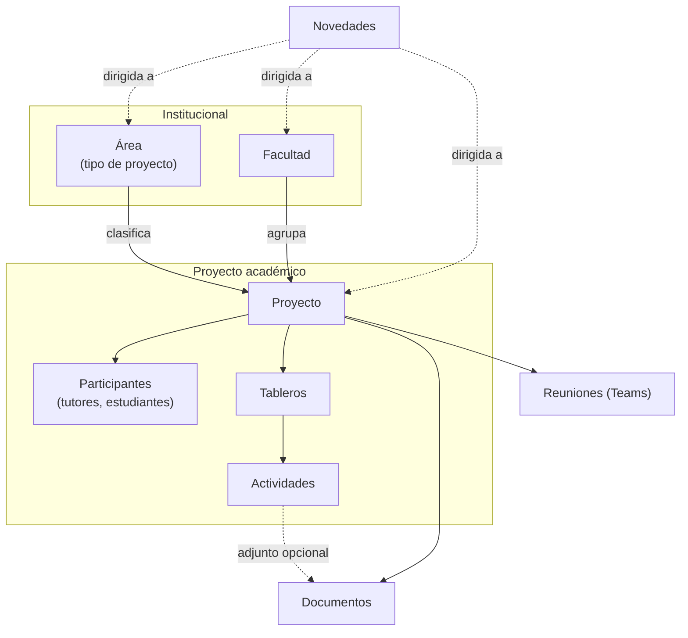

# Dominio del Gestor de Semilleros Universitarios

> **Estado:** planificación. Modelo conceptual en elaboración; nada de lo descrito está implementado.
> Este directorio es la **fuente de verdad del negocio**. Es independiente de la tecnología: los detalles relacionales y de Prisma viven en [`docs/database/`](../database/).

## Objetivo del sistema

Centralizar la administración de los **proyectos académicos** de la universidad (semilleros de investigación, proyectos de grado, tesis y otros tipos que se definan), junto con sus **participantes, tableros, actividades, documentos, reuniones y comunicaciones institucionales**.

## Cómo leer esta documentación

Cada afirmación está clasificada:

| Marca | Significado |
| --- | --- |
| ✅ **Confirmado** | Proviene directamente de la definición funcional aprobada. |
| 🟡 **Hipótesis** | Inferencia razonable que **no** debe implementarse sin confirmación. |
| ❓ **Pendiente** | Pregunta abierta; no hay información suficiente. |

> Si vas a implementar algo marcado como 🟡 o ❓, **detente y pregunta** (ver [`AGENTS.md`](../../AGENTS.md) §12).

## Índice

| Documento | Contenido |
| --- | --- |
| [`glossary.md`](glossary.md) | Términos del dominio y sus sinónimos |
| [`entities.md`](entities.md) | Entidades, atributos conceptuales, relaciones y cardinalidades |
| [`roles-permissions.md`](roles-permissions.md) | Roles, alcances y matriz conceptual de permisos |
| [`business-rules.md`](business-rules.md) | Reglas de negocio, restricciones y validaciones |
| [`workflows.md`](workflows.md) | Flujos principales del sistema |
| [`../database/data-model.md`](../database/data-model.md) | Propuesta de modelo relacional |
| [`../database/database-decisions.md`](../database/database-decisions.md) | Decisiones de diseño de datos y alternativas |

## Conceptos generales

- **Área**: tipo de proyecto académico (p. ej. semillero de investigación, proyecto de grado, tesis).
- **Facultad**: unidad académica a la que puede pertenecer un proyecto. Está a cargo de un decano.
- **Proyecto**: núcleo del dominio. Reúne participantes, tableros, actividades, documentos y reuniones.
- **Tablero → Actividad**: así se organiza el trabajo. Un tablero agrupa actividades con una meta común.
- **Documento**: metadatos de un archivo guardado en un almacenamiento externo.
- **Novedad**: comunicación dirigida a una audiencia (todos, roles, facultad, área o proyecto).
- **Reunión**: registro local de una reunión de Microsoft Teams.
- **Dashboards y métricas**: son **vistas derivadas** de los datos anteriores, no entidades propias.

## Módulos funcionales

Proyectos · Tableros · Documentos · Novedades. Reuniones, recordatorios y dashboards los complementan.

> La estructura de módulos del backend (`apps/backend/src/modules/`) usa nombres anteriores a este modelo, como `semilleros` y `tasks`. La correspondencia está pendiente de decisión. Ver [`database-decisions.md`](../database/database-decisions.md#pendientes-de-aprobación).

## Reglas para extender el dominio

1. Registra los términos nuevos en `glossary.md`.
2. Agrega o modifica entidades en `entities.md` y su reflejo relacional en `docs/database/data-model.md`.
3. Toda regla o permiso nuevo debe confirmarse antes de pasarlo de 🟡/❓ a ✅.
4. Las decisiones técnicas aprobadas se registran como ADR en `docs/decisions/`.
