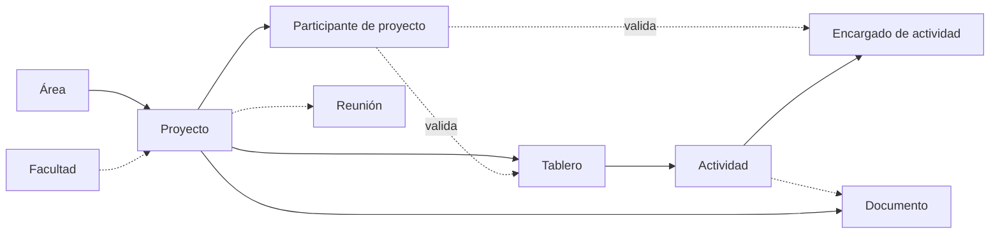

# Reglas de negocio

> **Estado:** reglas acordadas. El modelo de datos que las soporta está implementado en `apps/backend/prisma/schema.prisma`; la lógica de negocio (servicios) todavía no. No inventes reglas adicionales.
> Marcas: ✅ confirmada · 🟡 hipótesis (no implementar sin confirmar) · ❓ pendiente.
> Las reglas nuevas deben aprobarse y documentarse aquí antes de implementarse.

## 1. Reglas generales (acordadas previamente)

| ID | Regla | Estado |
| --- | --- | --- |
| RN-01 | El seguimiento debe poder filtrarse por **semillero, integrante, tutor, facultad y decano**. "Semillero" es un tipo de proyecto, es decir, un Área (P-01); "integrante" es un estudiante participante. | ✅ |
| RN-02 | En las tareas se distinguen **progreso** (avance) y **resultado** (desenlace). | ✅ |
| RN-03 | Estados permitidos para tableros y actividades: progreso (`pendiente`, `en progreso`, `finalizado`, `cancelado`) y resultado opcional (`éxito`, `fracaso`), en columnas separadas (P-11, DB-09). | ✅ |
| RN-04 | Un resultado (`éxito`/`fracaso`) no reemplaza al estado de progreso. | ✅ |
| RN-05 | Los recordatorios y las notificaciones pertenecen a un usuario o a un contexto; no son globales. | ✅ (tensión con RN-50 resuelta por P-16) |
| RN-06 | Los documentos e imágenes se almacenan en AWS S3; sus metadatos, en PostgreSQL. | ✅ |
| RN-07 | La lógica de negocio vive en los servicios del backend, no en la UI ni en los controladores de transporte. | ✅ |

## 2. Usuarios y roles

| ID | Regla | Estado |
| --- | --- | --- |
| RN-10 | Solo el Administrador crea usuarios, y lo hace con roles preestablecidos. | ✅ |
| RN-14 | Un usuario puede tener **varios roles globales**; sus permisos se suman (P-02, DB-01). | ✅ |
| RN-11 | Solo el Administrador modifica roles globales. El tutor solo cambia roles de proyecto de estudiantes (P-21). | ✅ ([ADR 0010](../decisions/0010-reglas-pendientes-resueltas.md)) |
| RN-12 | El tutor, en sus proyectos, añade y retira estudiantes y cambia su rol entre `STUDENT` y `STUDENT_LEADER` (máx. un líder). No gestiona tutores ni roles globales. | ✅ ([ADR 0010](../decisions/0010-reglas-pendientes-resueltas.md)) |
| RN-13 | Un usuario desactivado conserva su historial: autoría, participaciones y aprobaciones. | 🟡 |

## 3. Facultades, áreas y proyectos

| ID | Regla | Estado |
| --- | --- | --- |
| RN-20 | Un decano tiene una o varias facultades a su cargo. | ✅ |
| RN-21 | Un proyecto pertenece a **una o varias facultades** (mínimo una). El mínimo se valida en el servicio (P-04). | ✅ |
| RN-22 | Cada proyecto pertenece a exactamente un área (su tipo). El semillero es un tipo de proyecto (P-01). | ✅ |
| RN-23 | El decano solo crea, modifica o elimina proyectos de sus facultades; el encargado de área, los de sus áreas asignadas. Si ambos alcanzan el mismo proyecto, ninguno prevalece. | ✅ ([ADR 0010](../decisions/0010-reglas-pendientes-resueltas.md)) |
| RN-24 | Una facultad tiene, como máximo, un decano vigente. Se conserva el historial de decanos con vigencia (P-06, DB-03). | ✅ |
| RN-25 | El encargado de área solo actúa sobre sus áreas asignadas: edita su nombre y descripción y gestiona sus proyectos como el decano los de sus facultades. El administrador crea, elimina y asigna áreas, facultades, encargados y decanos. | ✅ ([ADR 0010](../decisions/0010-reglas-pendientes-resueltas.md)) |

## 4. Pertenencia a proyectos y asignación de tutores

| ID | Regla | Estado |
| --- | --- | --- |
| RN-30 | Un proyecto tiene participantes activos: decano, tutor y estudiantes. | ✅ |
| RN-31 | El decano asigna los tutores responsables de un proyecto. | ✅ |
| RN-32 | Un tutor puede tener uno o varios proyectos a su cargo. | ✅ |
| RN-33 | Un proyecto tiene al menos un tutor responsable mientras está activo. Puede tener varios, y uno se marca como **principal** (P-05). | ✅ (mínimo validado en el servicio) |
| RN-34 | Solo un usuario con rol global Tutor puede asignarse como tutor de un proyecto. | 🟡 |
| RN-35 | Un usuario no puede figurar dos veces como participante activo del mismo proyecto. | 🟡 |
| RN-36 | El decano de un proyecto se deriva de sus facultades (`project_faculties` → `faculty_deans`); no se asigna por separado. Un proyecto interfacultad puede tener varios decanos (P-07, DB-04). | ✅ |
| RN-37 | Un estudiante solo puede tener **un proyecto activo** a la vez (aplica a los roles de proyecto Estudiante y Estudiante líder). Un tutor puede tener varios (RN-32). | ✅ (P-25) |
| RN-38 | La salida de un participante se registra como inactivación (`status`, `left_at`), no como borrado; se conserva el historial de participación. | ✅ (P-25) |
| RN-39 | El **estudiante líder** es un rol de proyecto, no global. Un proyecto tiene como máximo un líder activo (P-03). | ✅ |
| RN-39a | Solo un tutor puede marcarse como **principal**; hay como máximo un tutor principal activo por proyecto (P-05). | ✅ |

## 5. Tableros y actividades

| ID | Regla | Estado |
| --- | --- | --- |
| RN-40 | Un tablero pertenece a un proyecto y agrupa actividades con una meta común. | ✅ (pertenencia 🟡) |
| RN-41 | Un tablero tiene título, fecha de entrega, estado de progreso, resultado opcional, **un** tutor responsable y **un** estudiante encargado (P-11, P-24). | ✅ |
| RN-42 | El tutor responsable de un tablero debe ser tutor activo del proyecto del tablero. Validación en el servicio (DB-05). | ✅ ([ADR 0010](../decisions/0010-reglas-pendientes-resueltas.md)) |
| RN-43 | El estudiante encargado de un tablero debe ser participante activo del mismo proyecto como estudiante o líder; no tiene que ser el líder. Validación en el servicio (DB-05). | ✅ ([ADR 0010](../decisions/0010-reglas-pendientes-resueltas.md)) |
| RN-44 | Una actividad pertenece a un único tablero. | ✅ |
| RN-45 | Una actividad tiene autor, progreso, resultado opcional, información, estado de aprobación del tutor y cero o más adjuntos (enlace o documento). | ✅ (P-11, P-14) |
| RN-46 | Una actividad puede tener **varios encargados** (P-10), que deben ser participantes activos del proyecto. Validación en el servicio (DB-05). | ✅ (cantidad) / 🟡 (validación) |
| RN-47 | El estudiante líder crea, modifica y elimina encargados de actividades según los permisos establecidos. | ✅ (cualquier actividad de su proyecto, [ADR 0010](../decisions/0010-reglas-pendientes-resueltas.md)) |
| RN-48 | Los estudiantes solo interactúan con las actividades que tienen asignadas. | ✅ (P-13, ver RN-85) |
| RN-49 | La aprobación de una actividad la registra un tutor del proyecto. El estado de aprobación (`pendiente`, `aprobada`, `rechazada`) es independiente del estado de la actividad. Solo se guarda el estado actual, con quién aprobó y cuándo; sin historial ni observaciones (P-12). | ✅ (cualquier tutor activo del proyecto, [ADR 0010](../decisions/0010-reglas-pendientes-resueltas.md)) |
| RN-49a | Una actividad solo puede aprobarse o rechazarse cuando su progreso es `DONE`; si sale de `DONE`, la aprobación vuelve a `PENDING`. | ✅ ([ADR 0010](../decisions/0010-reglas-pendientes-resueltas.md)) |
| RN-49b | Cada adjunto de una actividad es **o** un enlace **o** un documento, nunca ambos. Una actividad puede tener varios adjuntos (P-14, DB-07). | ✅ |

## 6. Distribución de novedades

| ID | Regla | Estado |
| --- | --- | --- |
| RN-50 | Una novedad puede dirigirse a todos los usuarios, a determinados roles, a una facultad, a un área o a un proyecto. | ✅ |
| RN-51 | El encargado de área publica novedades para sus áreas asignadas (audiencia `AREA`) y para roles (`ROLE`); no para todos (`ALL`). El tutor publica para los proyectos donde es tutor activo (`PROJECT`). | ✅ ([ADR 0010](../decisions/0010-reglas-pendientes-resueltas.md)) |
| RN-52 | El decano publica novedades para sus facultades o para proyectos específicos. | ✅ (proyectos de sus facultades, [ADR 0010](../decisions/0010-reglas-pendientes-resueltas.md)) |
| RN-53 | Una novedad puede tener varias audiencias. Un usuario la recibe si pertenece a **al menos una** (unión). | 🟡 |
| RN-54 | La audiencia se calcula al consultar; no hay registro de lectura (P-16, DB-06). Un usuario que se une después a un proyecto ve las novedades previas del proyecto. | ✅ (cálculo) / 🟡 (novedades previas) |
| RN-54a | Solo las noticias (`NEWS`) admiten archivos adjuntos: hasta 5, con las reglas de los documentos (25 MB, PDF/Word/Excel/imagen, firma validada). Los descarga quien puede ver la noticia; las copias externas solo avisan de que hay adjuntos. | ✅ ([ADR 0015](../decisions/0015-adjuntos-en-noticias.md)) |
| RN-55 | La información institucional de áreas y facultades se publica mediante novedades. | ✅ |
| RN-56 | Una **notificación** es un tipo de novedad (`NEWS`, `COMMUNICATION`, `CHANGE`, `NOTIFICATION`). Se envían copias por correo y WhatsApp según las preferencias de cada usuario (RN-89 a RN-93). | ✅ |

> **Tensión resuelta (P-16):** RN-05 dice que las notificaciones "no son globales" y RN-50 permite novedades "para todos". Como la notificación es un tipo de novedad (RN-56), RN-50 prevalece en cuanto a la audiencia: una novedad de cualquier tipo puede dirigirse a todos. RN-05 se aplica a los **recordatorios** y a las notificaciones dirigidas a un usuario o contexto concretos.

## 7. Documentos

| ID | Regla | Estado |
| --- | --- | --- |
| RN-60 | Formatos admitidos: PDF, Word, Excel e imágenes. | ✅ |
| RN-61 | El sistema guarda los metadatos y la referencia de acceso del archivo, no el binario. | ✅ |
| RN-62 | Web y móvil no acceden directamente al almacenamiento; el backend media el acceso. | ✅ (AGENTS.md) |
| RN-63 | Todo documento pertenece siempre a un proyecto y, opcionalmente, se adjunta a actividades (P-15). | ✅ |
| RN-64 | Máximo 25 MB por archivo; el tipo real se valida por la firma de los primeros bytes y debe coincidir con la extensión y el formato. | ✅ ([ADR 0013](../decisions/0013-documentos-en-s3.md)) |
| RN-65 | De cada documento se guarda la clave de almacenamiento (`storage_key`) de S3; el backend genera el enlace de acceso (P-15, DB-08). | ✅ |

## 8. Reuniones

| ID | Regla | Estado |
| --- | --- | --- |
| RN-70 | Las reuniones se integran con Microsoft Teams. | ✅ |
| RN-71 | Localmente se guardan fecha, motivo, participantes, enlace de acceso o grabación y duración. | ✅ |
| RN-72 | No se replica localmente toda la información de Teams. | ✅ |
| RN-73 | Crean reuniones el tutor (sus proyectos o sin proyecto), el decano (proyectos de sus facultades o sin proyecto), el encargado de área (proyectos de sus áreas o sin proyecto) y el administrador. | ✅ ([ADR 0010](../decisions/0010-reglas-pendientes-resueltas.md) §10) |
| RN-74 | Los participantes de una reunión son usuarios del sistema. El proyecto de la reunión es **opcional** (P-18). | ✅ |
| RN-75 | Al crear una reunión se agenda en el calendario de Microsoft Teams de la cuenta vinculada del organizador, con los participantes como invitados. Sin cuenta vinculada, o si Teams falla, no se crea. | ✅ ([ADR 0007](../decisions/0007-reuniones-con-microsoft-teams.md)) |
| RN-76 | Con proyecto, solo un tutor de ese proyecto (o el administrador) agenda la reunión, y los participantes deben ser miembros activos del proyecto. | ✅ (decisión técnica sobre RN-73) |
| RN-77 | Estados de la reunión: programada, en proceso, finalizada y cancelada. Pasa sola a en proceso al empezar y a finalizada al acabar; el organizador puede iniciarla, finalizarla o cancelarla antes. Cancelarla también la cancela en Teams. | ✅ |
| RN-78 | Los participantes reciben la invitación con el enlace al crearse la reunión y recordatorios 24 h y 1 h antes (también el organizador), por correo o WhatsApp según sus preferencias (tipo `MEETING`). | ✅ |
| RN-79 | El enlace de evidencia de la grabación es opcional y lo registra el organizador. | ✅ |

## 9. Recordatorios

| ID | Regla | Estado |
| --- | --- | --- |
| RN-80 | El tutor crea recordatorios. | ✅ |
| RN-81 | Un recordatorio pertenece a un usuario o a un contexto (ver RN-05). | ✅ |
| RN-82 | Los atributos y destinatarios del recordatorio están por definir; el modelo es mínimo y provisional (P-19). | ❓ |

## 10. Dependencias entre entidades

- No puede existir un tablero sin proyecto, ni una actividad sin tablero.
- Las validaciones de pertenencia (RN-42, RN-43 y RN-46) dependen de **Participante de proyecto**.
- La eliminación es **lógica** (`deleted_at`, P-20, DB-10): eliminar un proyecto no borra físicamente a sus dependientes. Los tableros, actividades, documentos y reuniones asociados quedan ocultos con él (el filtro es del servicio).
- Las restricciones de unicidad de la participación (RN-35, RN-37, RN-39, RN-39a) están garantizadas además en la base de datos (ver [`data-model.md`](../database/data-model.md) §6).

## 11. Validaciones en los límites del sistema

🟡 Son validaciones derivadas de las reglas anteriores. Se aplican en el backend:

- Fechas coherentes: la fecha de entrega de un tablero no es anterior a su creación (❓ si se exige), la duración de una reunión es positiva y la fecha de fin de un proyecto no es anterior a la de inicio.
- Todo proyecto tiene al menos una facultad (RN-21) y al menos un tutor activo (RN-33).
- Las referencias a usuarios (tutor responsable, encargados, participantes) deben corresponder a participantes activos del proyecto.
- El formato de documento pertenece al conjunto permitido (RN-60).
- Toda novedad tiene al menos una audiencia, y cada audiencia identifica un único destino.
- Un adjunto es un enlace o un documento, nunca ambos (RN-49b).
- Los enlaces (adjuntos, Teams) son URLs válidas.

---

## Permisos operativos de proyectos, tableros y actividades

> Confirmadas por el usuario el 2026-11-06 e implementadas ([ADR 0004](../decisions/0004-proyectos-tableros-actividades.md)).

| ID | Regla | Estado |
| --- | --- | --- |
| RN-83 | Los tableros los crean, modifican y eliminan los **tutores** activos del proyecto y el administrador. | ✅ |
| RN-84 | Las actividades las crean, editan y eliminan los **tutores**, el **estudiante líder** y el administrador; los mismos gestionan sus encargados. El tutor o el administrador fijan el resultado y la aprobación. | ✅ |
| RN-85 | El encargado de una actividad cambia su progreso (sin cancelarla) y añade o quita enlaces adjuntos. | ✅ |
| RN-86 | El administrador tiene acceso total a los proyectos. El decano crea y gestiona proyectos en los que dirige al menos una facultad; ve sus tableros pero no gestiona actividades. | ✅ |
| RN-87 | Participantes: el decano (o el administrador) asigna tutores y el tutor principal; decano y tutores añaden o retiran estudiantes y eligen al líder. Retirar es inactivar (con fecha de salida). | ✅ |
| RN-88 | Un usuario sin relación con un proyecto recibe "no encontrado" (404) en lugar de "prohibido", para no revelar su existencia. | ✅ (decisión técnica) |

## Copias de novedades por correo y WhatsApp

Reglas confirmadas por el usuario o tomadas como decisión técnica ([ADR 0005](../decisions/0005-notificaciones-y-copias-externas.md)).

| ID | Regla | Estado |
| --- | --- | --- |
| RN-89 | Al publicarse una novedad, cada destinatario de sus audiencias (excepto el autor) recibe una copia por los canales que tenga activados para ese **tipo** de novedad. | ✅ |
| RN-90 | Cada usuario elige, por tipo de novedad y por canal (correo, WhatsApp), si recibe copia. Por defecto el correo está activado y WhatsApp desactivado. | ✅ (valores por defecto: decisión técnica) |
| RN-91 | Para recibir copias por WhatsApp el usuario debe registrar un teléfono en formato E.164. | ✅ |
| RN-92 | La copia es complementaria: la novedad sigue visible en la plataforma aunque el usuario no reciba copias. | ✅ |
| RN-93 | Solo el decano (y el administrador) envían novedades del tipo `NOTIFICATION`; el administrador puede publicar en cualquier audiencia. | ✅ ([ADR 0010](../decisions/0010-reglas-pendientes-resueltas.md)) |

## Preguntas pendientes

Se conservan las preguntas resueltas, con su respuesta, para trazabilidad.

### Resueltas

| ID | Pregunta | Respuesta | Reglas / decisiones |
| --- | --- | --- | --- |
| P-01 | ¿Un semillero es un tipo de proyecto o un grupo que contiene proyectos? | ✅ Es un **tipo de proyecto** (un Área). No hay entidad Semillero. | RN-01, RN-22 |
| P-02 | ¿Un usuario puede tener varios roles globales? | ✅ Sí, **varios**. Sus permisos se suman. | RN-14, DB-01 |
| P-03 | ¿El estudiante líder es rol global o de proyecto? ¿Varios líderes? | ✅ Es un **rol de proyecto**; como máximo **uno** activo por proyecto. | RN-39, DB-02 |
| P-04 | ¿Todo proyecto debe pertenecer a una facultad? ¿A varias? | ✅ A **una o varias** facultades (mínimo una, validado en el servicio). | RN-21, DB-04 |
| P-05 | ¿Uno o varios tutores por proyecto? ¿Principal? | ✅ **Varios**, con **uno principal**. | RN-33, RN-39a |
| P-06 | ¿Un único decano vigente? ¿Historial? | ✅ Un decano vigente por facultad, con **historial** y vigencia. | RN-24, DB-03 |
| P-07 | ¿El decano es participante o se deriva de la facultad? | ✅ Se **deriva** de las facultades del proyecto (resuelta por DB-04). | RN-36, DB-04 |
| P-10 | ¿Uno o varios encargados por actividad? | ✅ **Varios**. | RN-46, `activity_assignees` |
| P-11 | ¿Qué estados tienen tablero y actividad? | ✅ Progreso (`PENDING`, `IN_PROGRESS`, `DONE`, `CANCELLED`) y resultado opcional separado (`SUCCESS`, `FAILURE`), en ambos. | RN-03, RN-41, DB-09 |
| P-12 | ¿Qué valores y qué historial tiene la aprobación? | ✅ `PENDING`, `APPROVED`, `REJECTED`; **solo el estado actual**, con quién y cuándo. Sin historial ni observaciones. | RN-49, DB-09 |
| P-09 | ¿Quién crea tableros y actividades? | ✅ Los **tutores** del proyecto crean tableros; **tutores y líder** crean actividades (con autor). El administrador tiene acceso total. | RN-83, RN-84 |
| P-13 | ¿Qué es "interactuar" con una actividad asignada? | ✅ El encargado cambia el **progreso** (`PENDING`, `IN_PROGRESS`, `DONE`; no `CANCELLED`) y gestiona **enlaces adjuntos**. No edita contenido, resultado ni aprobación. | RN-48, RN-85 |
| P-22 | ¿El administrador tiene acceso operativo? | ✅ **Total** sobre los proyectos (soporte). El decano gestiona solo los proyectos de **sus facultades** (al menos una). | RN-23, RN-86 |
| P-14 | ¿Adjunto único o múltiple? | ✅ **Varios** adjuntos, cada uno enlace o documento. | RN-49b, DB-07 |
| P-15 | ¿A qué contexto pertenece un documento? ¿Qué se guarda? | ✅ Siempre a un **proyecto**; se guarda `storage_key` de S3 y el backend genera el enlace. | RN-63, RN-65, DB-08 |
| P-16 | ¿Novedad y notificación son lo mismo? ¿Lectura? ¿Canales? | ✅ La notificación es un **tipo de novedad**; sin registro de lectura; audiencia calculada al consultar. Copias por **correo y WhatsApp** según las preferencias del usuario. | RN-54, RN-56, RN-89 a RN-93, DB-06, DB-15 |
| P-18 | ¿La reunión siempre tiene proyecto? ¿Participantes externos? | ✅ Proyecto **opcional**; participantes son usuarios del sistema. | RN-74 |
| P-20 | ¿Eliminación física o lógica? | ✅ **Lógica** (`deleted_at`). | DB-10 |
| P-25 | ¿Historial de participación? ¿Varios proyectos por estudiante? | ✅ Historial (`joined_at`, `left_at`, `status`); un estudiante solo puede tener **un proyecto activo**. | RN-37, RN-38, DB-02 |
| P-26 | ¿Qué estados tiene un proyecto? | ✅ `ACTIVE`, `FINISHED`, `CANCELLED`. | RN-33 |

### Pendientes

| ID | Pregunta | Afecta a |
| --- | --- | --- |
| P-08 | ✅ Encargado de área: solo sus áreas asignadas; edita su nombre y descripción y gestiona sus proyectos como el decano; sin precedencia frente al decano. ([ADR 0010](../decisions/0010-reglas-pendientes-resueltas.md)) | Área, permisos |
| P-17 | ✅ Administrador: cualquier audiencia; encargado de área: sus áreas y roles; decano: sus facultades y sus proyectos; tutor: sus proyectos. `NOTIFICATION` solo decano y administrador. ([ADR 0010](../decisions/0010-reglas-pendientes-resueltas.md)) | Permisos |
| P-19 | ¿Qué atributos y destinatarios tiene un **recordatorio**? ¿Por qué canal se envía? (Modelo mínimo provisional: `reminders`.) | Recordatorio |
| P-21 | ✅ El tutor añade y retira estudiantes y cambia `STUDENT` ↔ `STUDENT_LEADER`; no gestiona tutores ni roles globales. ([ADR 0010](../decisions/0010-reglas-pendientes-resueltas.md)) | Permisos |
| P-23 | ¿Cómo se corresponden los módulos del backend (`semilleros`, `tasks`, `notifications`…) con las nuevas entidades (Proyecto, Tablero, Actividad, Novedad)? | Arquitectura |
| P-24 | ✅ Tutor responsable: tutor activo del proyecto. Estudiante encargado: participante activo como estudiante o líder (no tiene que ser el líder). ([ADR 0010](../decisions/0010-reglas-pendientes-resueltas.md)) | Tablero |
