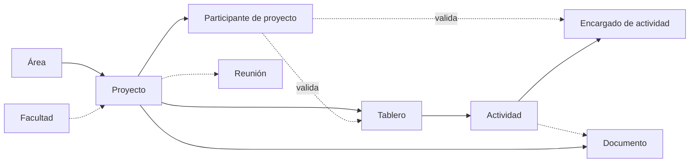

# Reglas de negocio

> **Estado:** planificación. Reglas acordadas, todavía no implementadas. No inventes reglas adicionales.
> Marcas: ✅ confirmada · 🟡 hipótesis (no implementar sin confirmar) · ❓ pendiente.
> Las reglas nuevas deben aprobarse y documentarse aquí antes de implementarse.

## 1. Reglas generales (acordadas previamente)

| ID | Regla | Estado |
| --- | --- | --- |
| RN-01 | El seguimiento debe poder filtrarse por **semillero, integrante, tutor, facultad y decano**. Con el modelo actual, "semillero" corresponde a proyecto o área (P-01) e "integrante", a estudiante participante. | ✅ (términos 🟡) |
| RN-02 | En las tareas se distinguen **progreso** (avance) y **resultado** (desenlace). | ✅ |
| RN-03 | Estados de tarea permitidos: `pendiente`, `en progreso`, `finalizado`, `cancelado`, `éxito`, `fracaso`. | ✅ (falta confirmar si aplican a Actividad, P-11) |
| RN-04 | Un resultado (`éxito`/`fracaso`) no reemplaza al estado de progreso. | ✅ |
| RN-05 | Los recordatorios y las notificaciones pertenecen a un usuario o a un contexto; no son globales. | ✅ (ver la tensión con RN-50) |
| RN-06 | Los documentos e imágenes se almacenan en AWS S3; sus metadatos, en PostgreSQL. | ✅ |
| RN-07 | La lógica de negocio vive en los servicios del backend, no en la UI ni en los controladores de transporte. | ✅ |

## 2. Usuarios y roles

| ID | Regla | Estado |
| --- | --- | --- |
| RN-10 | Solo el Administrador crea usuarios, y lo hace con roles preestablecidos. | ✅ |
| RN-11 | Solo el Administrador modifica roles globales. | 🟡 (el tutor también cambia roles de estudiantes, P-21) |
| RN-12 | El tutor solo puede cambiar el rol de estudiantes de sus proyectos y dentro de los límites definidos. | ✅ (límites ❓) |
| RN-13 | Un usuario desactivado conserva su historial: autoría, participaciones y aprobaciones. | 🟡 |

## 3. Facultades, áreas y proyectos

| ID | Regla | Estado |
| --- | --- | --- |
| RN-20 | Un decano tiene una o varias facultades a su cargo. | ✅ |
| RN-21 | Un proyecto puede pertenecer a una facultad. | ✅ (obligatoriedad ❓, P-04) |
| RN-22 | Cada proyecto pertenece a exactamente un área (su tipo). | 🟡 |
| RN-23 | El decano solo crea, modifica o elimina proyectos de sus facultades. | 🟡 |
| RN-24 | Una facultad tiene, como máximo, un decano vigente. | 🟡 (P-06) |
| RN-25 | El encargado de área solo administra las áreas que tiene asignadas. | ❓ (P-08) |

## 4. Pertenencia a proyectos y asignación de tutores

| ID | Regla | Estado |
| --- | --- | --- |
| RN-30 | Un proyecto tiene participantes activos: decano, tutor y estudiantes. | ✅ |
| RN-31 | El decano asigna los tutores responsables de un proyecto. | ✅ |
| RN-32 | Un tutor puede tener uno o varios proyectos a su cargo. | ✅ |
| RN-33 | Un proyecto tiene al menos un tutor responsable mientras está activo. | 🟡 (cantidad, P-05) |
| RN-34 | Solo un usuario con rol global Tutor puede asignarse como tutor de un proyecto. | 🟡 |
| RN-35 | Un usuario no puede figurar dos veces como participante activo del mismo proyecto. | 🟡 |
| RN-36 | El decano del proyecto es el de la facultad a la que pertenece; no se asigna por separado. | 🟡 (P-07) |
| RN-37 | Un estudiante puede participar en varios proyectos a la vez. | ❓ (P-25) |
| RN-38 | La salida de un participante se registra como inactivación, no como borrado. | 🟡 (P-25) |

## 5. Tableros y actividades

| ID | Regla | Estado |
| --- | --- | --- |
| RN-40 | Un tablero pertenece a un proyecto y agrupa actividades con una meta común. | ✅ (pertenencia 🟡) |
| RN-41 | Un tablero tiene título, fecha de entrega, estado, tutor responsable y estudiante encargado. | ✅ |
| RN-42 | El tutor responsable de un tablero debe ser tutor activo del proyecto del tablero. | 🟡 (P-24) |
| RN-43 | El estudiante encargado de un tablero debe ser estudiante activo del mismo proyecto. | 🟡 (P-24) |
| RN-44 | Una actividad pertenece a un único tablero. | ✅ |
| RN-45 | Una actividad tiene autor, estado, información, estado de aprobación del tutor y un adjunto opcional (enlace o documento). | ✅ |
| RN-46 | Los encargados de una actividad deben ser participantes activos del proyecto. | 🟡 |
| RN-47 | El estudiante líder crea, modifica y elimina encargados de actividades según los permisos establecidos. | ✅ (alcance ❓, P-10) |
| RN-48 | Los estudiantes solo interactúan con las actividades que tienen asignadas. | ✅ (qué es "interactuar" ❓, P-13) |
| RN-49 | La aprobación de una actividad la registra un tutor del proyecto. El estado de aprobación es independiente del estado de la actividad. | ✅ (qué tutor ❓, P-12) |
| RN-49a | Una actividad solo puede aprobarse cuando su progreso está en `finalizado`. | ❓ (no definido; no implementar) |
| RN-49b | El adjunto de una actividad es **o** un enlace **o** un documento, nunca ambos. | 🟡 (P-14) |

## 6. Distribución de novedades

| ID | Regla | Estado |
| --- | --- | --- |
| RN-50 | Una novedad puede dirigirse a todos los usuarios, a determinados roles, a una facultad, a un área o a un proyecto. | ✅ |
| RN-51 | El encargado de área publica novedades para todos los usuarios o para determinados roles. | ✅ |
| RN-52 | El decano publica novedades para sus facultades o para proyectos específicos. | ✅ (proyectos de sus facultades 🟡) |
| RN-53 | Una novedad puede tener varias audiencias. Un usuario la recibe si pertenece a **al menos una** (unión). | 🟡 (P-16) |
| RN-54 | La audiencia se calcula al consultar. Un usuario que se une después a un proyecto ve las novedades previas del proyecto. | 🟡 (DB-06) |
| RN-55 | La información institucional de áreas y facultades se publica mediante novedades. | ✅ |

> **Tensión detectada:** RN-05 dice que las notificaciones "no son globales", mientras que RN-50 permite novedades "para todos". Si novedad y notificación son conceptos distintos, no hay contradicción. Está pendiente confirmarlo (P-16).

## 7. Documentos

| ID | Regla | Estado |
| --- | --- | --- |
| RN-60 | Formatos admitidos: PDF, Word, Excel e imágenes. | ✅ |
| RN-61 | El sistema guarda los metadatos y la referencia de acceso del archivo, no el binario. | ✅ |
| RN-62 | Web y móvil no acceden directamente al almacenamiento; el backend media el acceso. | ✅ (AGENTS.md) |
| RN-63 | Todo documento queda asociado a un contexto (proyecto y, opcionalmente, actividad). | 🟡 (P-15) |
| RN-64 | El tamaño máximo y la validación del tipo real de archivo están por definir. | ❓ |

## 8. Reuniones

| ID | Regla | Estado |
| --- | --- | --- |
| RN-70 | Las reuniones se integran con Microsoft Teams. | ✅ |
| RN-71 | Localmente se guardan fecha, motivo, participantes, enlace de acceso o grabación y duración. | ✅ |
| RN-72 | No se replica localmente toda la información de Teams. | ✅ |
| RN-73 | El tutor crea las reuniones. | ✅ (otros roles ❓) |
| RN-74 | Los participantes de una reunión son usuarios del sistema vinculados al proyecto. | 🟡 (externos, P-18) |

## 9. Recordatorios

| ID | Regla | Estado |
| --- | --- | --- |
| RN-80 | El tutor crea recordatorios. | ✅ |
| RN-81 | Un recordatorio pertenece a un usuario o a un contexto (ver RN-05). | ✅ |

## 10. Dependencias entre entidades

- No puede existir un tablero sin proyecto, ni una actividad sin tablero.
- Las validaciones de pertenencia (RN-42, RN-43 y RN-46) dependen de **Participante de proyecto**.
- La eliminación de un proyecto afecta a todos sus dependientes (P-20).

## 11. Validaciones en los límites del sistema

🟡 Son validaciones derivadas de las reglas anteriores. Se aplican en el backend:

- Fechas coherentes: la fecha de entrega de un tablero no es anterior a su creación (❓ si se exige) y la duración de una reunión es positiva.
- Las referencias a usuarios (tutor responsable, encargados, participantes) deben corresponder a participantes activos del proyecto.
- El formato de documento pertenece al conjunto permitido (RN-60).
- Toda novedad tiene al menos una audiencia, y cada audiencia identifica un único destino.
- Los enlaces (adjuntos, Teams) son URLs válidas.

---

## Preguntas pendientes

| ID | Pregunta | Afecta a |
| --- | --- | --- |
| P-01 | ¿Un **semillero** es un tipo de proyecto (Área) o un grupo estable que contiene varios proyectos a lo largo del tiempo? | Modelo central |
| P-02 | ¿Un usuario puede tener **varios roles globales** (p. ej. Tutor y Decano)? ¿Cómo se combinan sus permisos? | Usuario, permisos |
| P-03 | ¿**Estudiante líder** es un rol global o un rol de proyecto? ¿Puede haber varios líderes por proyecto? | Participante de proyecto |
| P-04 | ¿Todo proyecto **debe** pertenecer a una facultad? ¿Puede pertenecer a varias (proyectos interfacultad)? | Proyecto |
| P-05 | ¿Un proyecto tiene **uno o varios tutores**? ¿Hay un tutor principal? | Proyecto, Tablero |
| P-06 | ¿Una facultad tiene **un único decano vigente**? ¿Se debe guardar el historial de decanos? | Asignación de decano |
| P-07 | ¿El decano se registra como **participante** del proyecto o su vínculo se deriva de la facultad? | Participante de proyecto |
| P-08 | ¿El **encargado de área** actúa sobre áreas asignadas o sobre todas? ¿Puede crear o modificar proyectos? ¿Qué es "administrar información de áreas"? | Área, permisos |
| P-09 | ¿Quién crea **tableros** y quién crea **actividades**? ¿"Tarea" equivale a actividad? | Permisos |
| P-10 | ¿Una actividad tiene **uno o varios encargados**? ¿Sobre qué actividades actúa el líder ("otras actividades")? | Encargado de actividad |
| P-11 | ¿Qué valores tienen los **estados de tablero** y de **actividad**? ¿Se aplican a la actividad los estados de progreso y resultado de RN-03? | Tablero, Actividad |
| P-12 | ¿Qué valores tiene el **estado de aprobación** (pendiente, aprobada, rechazada…)? ¿Qué tutor aprueba? ¿Se guarda historial y observaciones? ¿Se puede revertir? | Actividad |
| P-13 | ¿Qué significa **interactuar** con una actividad: cambiar el estado, adjuntar, comentar, editar? | Permisos |
| P-14 | ¿El adjunto es **único o múltiple**? ¿Un enlace externo se registra como Documento? | Actividad, Documento |
| P-15 | ¿A qué contexto pertenece un **documento**: proyecto, actividad, novedad? ¿Quién puede subir, ver o eliminar? ¿Hay versionado? | Documento |
| P-16 | ¿**Novedad** y **notificación** son lo mismo? ¿Qué canales hay (app, WhatsApp, correo)? ¿Se registra la lectura? ¿Las audiencias se combinan? ¿Las novedades expiran? | Novedad |
| P-17 | ¿El administrador o el tutor pueden publicar novedades? ¿A qué audiencias? | Permisos |
| P-18 | ¿Una reunión siempre pertenece a un proyecto? ¿Admite participantes sin cuenta? ¿Quién más puede crearlas? ¿Cómo se sincroniza con Teams? | Reunión |
| P-19 | ¿Qué atributos y destinatarios tiene un **recordatorio**? ¿Por qué canal se envía? | Recordatorio |
| P-20 | ¿La eliminación es **física o lógica**? ¿Qué pasa con tableros, actividades, documentos y reuniones al eliminar un proyecto? | Integridad |
| P-21 | ¿Cuáles son los **límites del tutor** al cambiar roles de estudiantes? | Permisos |
| P-22 | ¿El **administrador** tiene acceso operativo total o solo de gestión de usuarios y métricas? | Permisos |
| P-23 | ¿Cómo se corresponden los módulos del backend (`semilleros`, `tasks`, `notifications`…) con las nuevas entidades (Proyecto, Tablero, Actividad, Novedad)? | Arquitectura |
| P-24 | En un tablero, ¿el tutor responsable y el estudiante encargado son únicos? ¿Deben ser participantes del proyecto? ¿El estudiante encargado es el líder? | Tablero |
| P-25 | ¿Hace falta el **historial de participación** (ingreso y salida)? ¿Un estudiante puede estar en varios proyectos a la vez? | Participante de proyecto |
| P-26 | ¿Qué **estados o ciclo de vida** tiene un proyecto (activo, finalizado, cancelado…)? | Proyecto |
