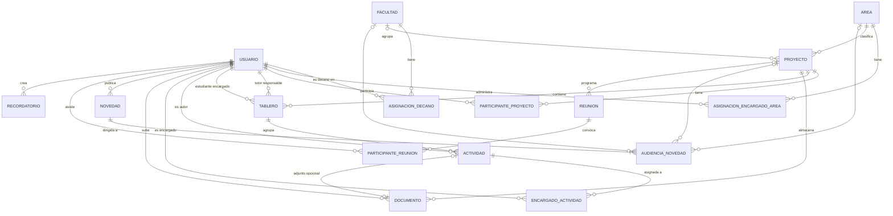
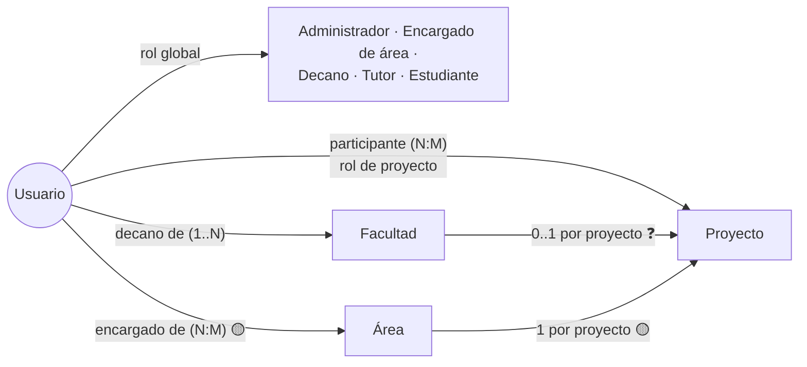
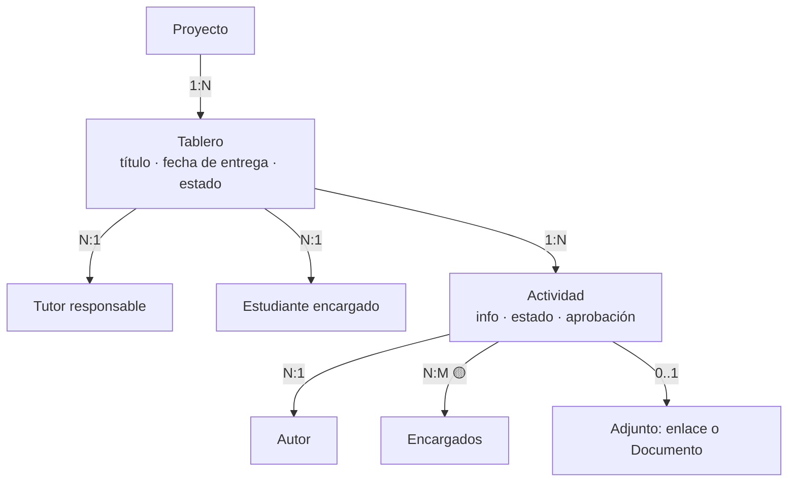

# Entidades del dominio

> **Estado:** planificación. Modelo **conceptual**: no todas las entidades se convertirán en tablas, y algunas tablas no son entidades del negocio. La traducción relacional está en [`../database/data-model.md`](../database/data-model.md).
> Marcas: ✅ confirmado · 🟡 hipótesis · ❓ pendiente. Los códigos `P-xx` remiten a las [preguntas pendientes](business-rules.md#preguntas-pendientes).

## Índice

- [Entidades principales](#entidades-principales): Usuario, Área, Facultad, Proyecto, Tablero, Actividad, Documento, Novedad y Reunión.
- [Entidades secundarias y asociativas](#entidades-secundarias-y-asociativas).
- [Conceptos que no son entidades](#conceptos-que-no-son-entidades).
- [Resumen de relaciones y cardinalidades](#resumen-de-relaciones-y-cardinalidades).
- [Diagrama entidad-relación conceptual](#diagrama-entidad-relación-conceptual).

---

## Entidades principales

### Usuario

Persona con cuenta en la plataforma. La entidad no aparece de forma explícita en la definición funcional, pero todos los roles dependen de ella.

| Atributo conceptual | Estado | Notas |
| --- | --- | --- |
| Nombre completo | 🟡 | |
| Correo electrónico | 🟡 | Se supone único e institucional. |
| Rol(es) global(es) | ✅ | Falta confirmar si son uno o varios (P-02). |
| Estado (activo/inactivo) | 🟡 | Permite desactivar sin perder el historial. |
| Datos de autenticación | — | Los gestiona **Auth.js**; están fuera del dominio. |

**Responsabilidades:** identificar a la persona y concentrar sus roles y vinculaciones.
**Relaciones:** se vincula con facultades (decano), áreas (encargado), proyectos (participante), tableros, actividades, documentos, novedades y reuniones.

### Área

Tipo de proyecto académico, por ejemplo *semillero de investigación*, *proyecto de grado* o *tesis*.

| Atributo conceptual | Estado | Notas |
| --- | --- | --- |
| Nombre | ✅ | Implícito en los ejemplos. |
| Descripción | 🟡 | |
| Información institucional | ✅ | Se publica **mediante novedades** y no como atributo del área. |

**Responsabilidades:** clasificar proyectos y servir de audiencia para novedades.
**Relaciones:**
- Área **1 : N** Proyecto. Cada proyecto tiene un único tipo (🟡, se deduce de "representa el tipo de proyecto").
- Área **N : M** Usuario, como encargado de área (🟡, P-08).
- Área **1 : N** Audiencia de novedad.

> ❓ P-01: hay que confirmar si "Semillero de investigación" es un tipo de proyecto o un grupo que contiene proyectos. Si es un grupo, aparecería una entidad **Semillero** entre Área y Proyecto.

### Facultad

Facultad de la universidad.

| Atributo conceptual | Estado | Notas |
| --- | --- | --- |
| Nombre | 🟡 | |
| Código institucional | ❓ | No se debe inventar. |
| Información institucional | ✅ | Se publica mediante novedades. |

**Responsabilidades:** agrupar proyectos y delimitar el alcance del decano.
**Relaciones:**
- Facultad **1 : N** Proyecto. La pertenencia es posible, pero falta confirmar si es obligatoria (P-04).
- Decano **1 : N** Facultad (✅, "una o varias facultades a su cargo"). Falta confirmar si una facultad tiene un único decano vigente (P-06).

### Proyecto

Proyecto académico en desarrollo. Es el **núcleo del dominio**.

| Atributo conceptual | Estado | Notas |
| --- | --- | --- |
| Título | 🟡 | |
| Descripción / información | ✅ | "Gestionar su información". |
| Área (tipo) | 🟡 | Obligatoria, una por proyecto. |
| Facultad | ✅ / ❓ | "Pueden pertenecer"; falta confirmar la obligatoriedad (P-04). |
| Estado / ciclo de vida | ❓ | No hay valores definidos (P-26). |
| Fechas (inicio, fin) | 🟡 | |
| Creado por | 🟡 | Un decano, según los permisos. |

**Responsabilidades:** contener participantes, tableros, actividades, documentos y reuniones.
**Relaciones:**
- Proyecto **N : M** Usuario, a través de **Participante de proyecto**.
- Proyecto **1 : N** Tablero.
- Proyecto **1 : N** Documento (🟡, P-15).
- Proyecto **1 : N** Reunión (🟡, P-18).

### Tablero

Recopilación de actividades relacionadas con una meta común.

| Atributo conceptual | Estado | Notas |
| --- | --- | --- |
| Título | ✅ | |
| Fecha de entrega | ✅ | |
| Estado | ✅ | No hay valores definidos (P-11). |
| Tutor responsable | ✅ | Debe ser tutor del proyecto (🟡, P-24). |
| Estudiante encargado | ✅ | Debe ser estudiante del proyecto (🟡, P-24). |
| Proyecto | 🟡 | Se deduce de "gestionar sus tableros". |

**Responsabilidades:** agrupar y dar seguimiento a un conjunto de actividades.
**Relaciones:** Proyecto **1 : N** Tablero; Tablero **1 : N** Actividad; Tablero **N : 1** Usuario (tutor responsable); Tablero **N : 1** Usuario (estudiante encargado).

### Actividad

Tarea o unidad de trabajo pequeña dentro de un tablero.

| Atributo conceptual | Estado | Notas |
| --- | --- | --- |
| Información (título, descripción) | ✅ | |
| Autor | ✅ | Usuario que la creó. |
| Estado | ✅ | Falta confirmar si se distinguen progreso y resultado (P-11). |
| Estado de aprobación del tutor | ✅ | No hay valores definidos (P-12). |
| Adjunto opcional | ✅ | Puede ser un enlace o un documento (P-14). |
| Encargado(s) | ✅ / ❓ | Se infiere del permiso del líder; falta la cardinalidad (P-10). |
| Fecha límite | ❓ | No está definida. |

**Responsabilidades:** representar el trabajo asignable, verificable y aprobable.
**Relaciones:** Tablero **1 : N** Actividad; Actividad **N : 1** Usuario (autor); Actividad **N : M** Usuario (encargados, 🟡); Actividad **0..1** Adjunto; Actividad **N : 1** Usuario (tutor que aprueba, 🟡).

### Documento

Archivo guardado en un servidor externo y accesible por API. El sistema guarda los **metadatos**, no el binario.

| Atributo conceptual | Estado | Notas |
| --- | --- | --- |
| Nombre | 🟡 | |
| Formato | ✅ | PDF, Word, Excel o imagen. |
| Enlace de descarga / referencia de acceso | ✅ | Ver la decisión DB-08 sobre URL frente a clave de almacenamiento. |
| Tamaño | 🟡 | |
| Subido por | 🟡 | |
| Fecha de carga | 🟡 | |
| Contexto (proyecto, actividad…) | ❓ | P-15. |

**Responsabilidades:** permitir identificar y recuperar el archivo externo.
**Relaciones:** Documento **N : 1** Usuario (autor de la carga); Documento **N : 1** Proyecto (🟡); Documento **0..1 : 1** Actividad, como adjunto.

### Novedad

Noticia, comunicación, cambio o notificación dirigida a un grupo de usuarios.

| Atributo conceptual | Estado | Notas |
| --- | --- | --- |
| Título | 🟡 | |
| Contenido | ✅ | |
| Tipo (noticia, comunicación, cambio, notificación) | 🟡 | Se deduce de la definición. |
| Autor | 🟡 | |
| Fecha de publicación | 🟡 | |
| Audiencia(s) | ✅ | Todos, roles, facultad, área o proyecto. |
| Vigencia / expiración | ❓ | P-16. |

**Responsabilidades:** comunicar información institucional a una audiencia acotada.
**Relaciones:** Novedad **N : 1** Usuario (autor); Novedad **1 : N** Audiencia de novedad.

### Reunión

Registro local de una reunión de **Microsoft Teams**. No replica toda la información que gestiona Teams.

| Atributo conceptual | Estado | Notas |
| --- | --- | --- |
| Fecha (y hora) | ✅ | |
| Motivo | ✅ | |
| Participantes | ✅ | Relación N:M con usuarios. |
| Enlace de acceso | ✅ | |
| Enlace de grabación | ✅ | "Enlace de acceso **o** grabación"; se proponen dos atributos opcionales. |
| Duración | ✅ | |
| Identificador externo de Teams | 🟡 | Necesario para sincronizar. |
| Proyecto | 🟡 | P-18. |
| Organizador | 🟡 | Probablemente un tutor. |

**Responsabilidades:** registrar la reunión y su acceso sin depender de consultar Teams cada vez.
**Relaciones:** Reunión **N : M** Usuario, a través de **Participante de reunión**; Reunión **N : 1** Proyecto (🟡).

---

## Entidades secundarias y asociativas

| Entidad | Tipo | Une | Atributos propios | Estado |
| --- | --- | --- | --- | --- |
| **Asignación de rol global** | Asociativa | Usuario ↔ Rol | Fecha de asignación, asignado por | 🟡 Solo si un usuario puede tener varios roles (P-02). |
| **Asignación de decano** | Asociativa | Usuario (decano) ↔ Facultad | Vigencia (desde/hasta) | 🟡 P-06 |
| **Asignación de encargado de área** | Asociativa | Usuario ↔ Área | Vigencia | 🟡 P-08 |
| **Participante de proyecto** | Asociativa | Usuario ↔ Proyecto | Rol de proyecto, estado (activo/inactivo), fecha de ingreso y salida | 🟡 Es necesaria: el proyecto tiene varios participantes y un usuario participa en varios proyectos. |
| **Encargado de actividad** | Asociativa | Usuario ↔ Actividad | Asignado por, fecha | 🟡 P-10 |
| **Audiencia de novedad** | Asociativa | Novedad ↔ (todos / rol / facultad / área / proyecto) | Tipo de audiencia | 🟡 Sistema de destinatarios flexible. Ver DB-06. |
| **Participante de reunión** | Asociativa | Usuario ↔ Reunión | Asistencia (❓) | 🟡 |
| **Recordatorio** | Secundaria | Usuario (creador), Proyecto (❓) | Título, fecha y hora, destinatarios (❓) | ✅ Existe / ❓ P-19 |
| **Adjunto de actividad** | Componente | Actividad → (enlace o Documento) | Tipo, URL o documento | 🟡 Puede resolverse con atributos de la actividad. Ver DB-07. |
| **Rol** (catálogo) | Catálogo | — | Nombre | 🟡 Conjunto cerrado y pequeño; puede modelarse como enumeración. |
| **Rol de proyecto** (catálogo) | Catálogo | — | Tutor, Estudiante, Estudiante líder… | 🟡 P-03 |

---

## Conceptos que no son entidades

| Concepto | Tratamiento | Motivo |
| --- | --- | --- |
| Dashboard / métricas | Consultas derivadas | Persistirlas duplicaría información, salvo que se decida cachearlas. |
| Información institucional de un área o facultad | Novedades con esa audiencia | Lo define así la propia descripción funcional. |
| Sesión, cuenta y credenciales | Las gestiona Auth.js | Están fuera del dominio de negocio. |
| Datos completos de Teams | No se almacenan | Restricción confirmada. |
| Binario del documento | Almacenamiento externo (AWS S3) | Restricción confirmada. |

---

## Resumen de relaciones y cardinalidades

| Relación | Cardinalidad | Estado | Mecanismo |
| --- | --- | --- | --- |
| Área – Proyecto | 1 : N | 🟡 | Referencia en Proyecto |
| Facultad – Proyecto | 1 : N (0..1 por proyecto) | ✅ / ❓ obligatoriedad | Referencia en Proyecto |
| Decano – Facultad | 1 : N (N : M si hay historial o codecanos) | ✅ / ❓ | Asignación de decano |
| Encargado – Área | N : M | 🟡 | Asignación de encargado |
| Usuario – Proyecto | N : M | ✅ | Participante de proyecto |
| Proyecto – Tablero | 1 : N | 🟡 | Referencia en Tablero |
| Tablero – Actividad | 1 : N | ✅ | Referencia en Actividad |
| Tablero – Tutor responsable | N : 1 | ✅ | Referencia en Tablero |
| Tablero – Estudiante encargado | N : 1 | ✅ | Referencia en Tablero |
| Actividad – Autor | N : 1 | ✅ | Referencia en Actividad |
| Actividad – Encargados | N : M | 🟡 | Encargado de actividad |
| Actividad – Adjunto | 1 : 0..1 | ✅ | Atributos o referencia a Documento |
| Proyecto – Documento | 1 : N | 🟡 | Referencia en Documento |
| Novedad – Audiencia | 1 : N | 🟡 | Audiencia de novedad |
| Reunión – Usuario | N : M | ✅ | Participante de reunión |
| Proyecto – Reunión | 1 : N | 🟡 | Referencia en Reunión |

---

## Diagrama entidad-relación conceptual

Las líneas reflejan la propuesta e incluyen hipótesis. El detalle de cada relación está en las tablas anteriores.

### Usuarios, proyectos, facultades y áreas

### Tableros y actividades

