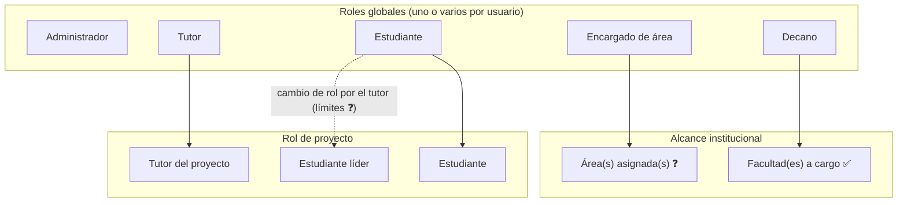

# Roles y permisos

> **Estado:** definición funcional. Es una **matriz conceptual**. Los roles globales y de proyecto existen en el modelo de datos (`user_roles`, `project_members`). **Implementado hoy** en el backend: `SessionGuard` (autenticación), `RolesGuard` + `@Roles` (rol global), **crear usuarios (solo `ADMIN`)**, el **directorio de usuarios** para seleccionar personas (`GET /api/users`, solo `ADMIN`, `DEAN` y `TUTOR`) y los **catálogos de áreas y facultades** (`GET /api/areas`, `GET /api/faculties`, cualquier sesión), según el [ADR 0009](../decisions/0009-directorio-catalogos-y-paneles.md), y la **autorización por proyecto** de proyectos, participantes, tableros y actividades (`can.*` en `apps/backend/src/modules/projects/models/project-access.ts`, [ADR 0004](../decisions/0004-proyectos-tableros-actividades.md)). Las celdas marcadas ✅ en la matriz de proyectos, tableros y actividades están implementadas. También están implementadas la **publicación de novedades y notificaciones** y las preferencias de copias (`notifications/models/publish-scope.ts`, [ADR 0005](../decisions/0005-notificaciones-y-copias-externas.md)). También las **reuniones con Microsoft Teams** ([ADR 0007](../decisions/0007-reuniones-con-microsoft-teams.md)). También están implementados (ADR 0009 y 0010) el directorio de usuarios, los catálogos, el panel por rol, la administración de áreas, facultades, encargados y decanos, los permisos del encargado de área sobre los proyectos de sus áreas, la aprobación solo con la actividad en `DONE` y la publicación de novedades por rol. No están implementados los permisos de documentos ni de recordatorios.
> **No inventes permisos.** Lo que no aparece como ✅ requiere confirmación antes de implementarse.
> Marcas: ✅ confirmado · 🟡 hipótesis · ❓ pendiente · `—` no definido. Los códigos `P-xx` remiten a las [preguntas pendientes](business-rules.md#preguntas-pendientes).

- **Auth.js** es el mecanismo de autenticación y autorización.
- **Un usuario puede tener varios roles globales** y sus permisos se **suman** (P-02, DB-01). Ejemplo: un docente que es Tutor y Decano tiene los permisos de ambos, cada uno con su propio alcance.
- Cualquier permiso nuevo debe registrarse en este documento.
- Si la definición afecta la arquitectura, registra además un ADR en `docs/decisions/`.

## 1. Tipos de alcance

Los permisos se definen en tres niveles. Distinguirlos evita conflictos:

| Nivel | Qué determina | Ejemplo |
| --- | --- | --- |
| **Rol global** | Qué puede hacer el usuario en el sistema | Un Administrador crea usuarios. |
| **Responsabilidad en facultad o área** | Sobre qué subconjunto institucional actúa | Un Decano gestiona los proyectos **de sus facultades**. |
| **Rol de proyecto** | Qué puede hacer dentro de un proyecto concreto | Un Tutor crea tareas **en sus proyectos**. |

> ✅ **P-03:** el *estudiante líder* es un **rol de proyecto**, no un rol global (`project_role = STUDENT_LEADER`). Hay como máximo **un líder activo por proyecto**. Los roles globales son Administrador, Encargado de área, Decano, Tutor y Estudiante. Los límites del tutor al cambiar el rol de un estudiante siguen pendientes (P-21).

## 2. Definición de roles

### Administrador
- **Alcance:** todo el sistema.
- ✅ Modificar roles.
- ✅ Crear usuarios con roles preestablecidos. Implementado en `POST /api/users` ([ADR 0003](../decisions/0003-alta-de-usuarios.md)).
- ✅ Consultar métricas generales mediante dashboards.
- ❓ No está definido si tiene acceso operativo sobre proyectos, tableros o novedades (P-22).

### Encargado de área
- **Alcance:** solo sus áreas asignadas (`area_managers`) ✅ (ADR 0010).
- ✅ Editar el nombre y la descripción de sus áreas.
- ✅ Crear, modificar y eliminar los proyectos de sus áreas y gestionar sus tutores y estudiantes, como el decano en sus facultades; si ambos alcanzan un proyecto, ninguno prevalece.
- ✅ Publicar novedades dirigidas a sus áreas o a roles.
- ✅ Consultar métricas de sus áreas mediante el panel.

### Decano
- **Alcance:** una o varias facultades a su cargo ✅.
- ✅ Crear, modificar y eliminar proyectos de sus facultades.
- ✅ Asignar tutores responsables a los proyectos.
- ✅ Enviar notificaciones (P-16).
- ✅ Publicar información general dirigida a sus facultades o a proyectos de sus facultades.
- ✅ Consultar información y métricas de sus facultades.

### Tutor
- **Alcance:** uno o varios proyectos a su cargo ✅.
- ✅ Crear tareas, reuniones y recordatorios. Falta confirmar si "tarea" es una actividad o un tablero (P-09).
- ✅ Añadir y retirar estudiantes y cambiar su rol entre Estudiante y Líder (P-21); no gestiona tutores.
- ✅ Publicar novedades para sus proyectos (no del tipo notificación).
- ✅ Aprobar o rechazar actividades finalizadas (`DONE`) de sus proyectos; cualquier tutor activo del proyecto puede hacerlo.
- ✅ Consultar información y métricas de sus proyectos.

### Estudiante líder de grupo
- **Alcance:** su proyecto (rol de proyecto, máximo uno por proyecto) y las actividades que tiene asignadas.
- ✅ Interactuar con las actividades que tiene asignadas (P-13).
- ✅ Crear, modificar y eliminar **encargados** en cualquier actividad de su proyecto (P-10, ADR 0010).
- ✅ Consultar la información de su proyecto mediante un dashboard.

### Estudiante
- **Alcance:** las actividades que tiene asignadas y su proyecto.
- ✅ Interactuar con las actividades que tiene asignadas (P-13).
- ✅ Consultar la información de su proyecto mediante un dashboard.

## 3. Matriz conceptual de permisos

Leyenda: **C** crear · **R** consultar · **U** modificar · **D** eliminar · **A** aprobar · **I** interactuar.
Una celda sin marca de estado está ✅ confirmada. Las celdas `—` no tienen permiso definido, **lo que no equivale a una denegación confirmada**.

| Recurso | Administrador | Encargado de área | Decano | Tutor | Estudiante líder | Estudiante |
| --- | --- | --- | --- | --- | --- | --- |
| Usuarios | C (implementado) · R (directorio, ADR 0009) | — | R (directorio, ADR 0009) | R (directorio, ADR 0009) | — | — |
| Roles globales | U (solo se asignan al crear el usuario; modificarlos no está implementado) | — | — | — | — | — |
| Rol de estudiante en proyecto (incluye líder, máx. uno) | U ✅ | U (sus áreas) ✅ | U (sus facultades) ✅ | U (`STUDENT` ↔ `STUDENT_LEADER`, ADR 0010) ✅ | — | — |
| Áreas | C R U D · asignar encargados (ADR 0010) ✅ | R · U (nombre y descripción de sus áreas, ADR 0010) ✅ | R (catálogo, ADR 0009) | R (catálogo, ADR 0009) | R (catálogo, ADR 0009) | R (catálogo, ADR 0009) |
| Facultades | C R U D · asignar decano vigente (ADR 0010) ✅ | — · R (catálogo, ADR 0009) | R (sus facultades) · R (catálogo, ADR 0009) | R (catálogo, ADR 0009) | R (catálogo, ADR 0009) | R (catálogo, ADR 0009) |
| Proyectos | C R U D (todos) ✅ | C R U D (sus áreas, ADR 0010) ✅ | C R U D (sus facultades) ✅ | R (sus proyectos) | R (su proyecto) | R (su proyecto) |
| Asignación de tutor a proyecto | C U D ✅ | C U D (sus áreas) ✅ | C U D ✅ | — | — | — |
| Estudiantes y líder del proyecto | C U D ✅ | C U D (sus áreas) ✅ | C U D ✅ | C U D ✅ | — | — |
| Tableros | C R U D ✅ | — | R ✅ | C R U D ✅ | R | R |
| Actividades | C R U D A ✅ | — | R ✅ | C R U D A ✅ | C R U D ✅ · I | R · I (asignadas: progreso y enlaces) ✅ |
| Encargados de actividad | C U D ✅ | — | — | C U D ✅ | C U D ✅ | — |
| Reuniones | C R U (todas; supuesto 🟡) ✅ | — | — | C (sus proyectos o sin proyecto) · R U (las que organiza) ✅ | R (si es participante) ✅ | R (si es participante) ✅ |
| Recordatorios | — | — | — | C | — | — |
| Documentos | — | — | — | — ❓ | — ❓ | — ❓ |
| Novedades | C R D (todas) ✅ | C (sus áreas / roles) · D (propias) ✅ | C (sus facultades / proyectos de ellas) · D (propias) ✅ | C (sus proyectos; no `NOTIFICATION`) · D (propias) ✅ | — | — |
| Notificaciones | C (supuesto 🟡) ✅ | — | C (P-16) ✅ | — | — | — |
| Lectura de novedades | R (todas) ✅ | R (audiencia) ✅ | R (audiencia) ✅ | R (audiencia) ✅ | R (audiencia) ✅ | R (audiencia) ✅ |
| Preferencias de copias (propias) | U ✅ | U ✅ | U ✅ | U ✅ | U ✅ | U ✅ |
| Dashboard | R (general) | R (sus áreas asignadas; métricas, ADR 0009) | R (sus facultades) | R (sus proyectos) | R (su proyecto) | R (su proyecto) |

## 4. Restricciones conocidas

- ✅ El alcance del decano se limita a **sus facultades** en información y métricas.
- ✅ El alcance del tutor se limita a **sus proyectos** en información y métricas.
- ✅ Estudiantes y líderes solo interactúan con las actividades **que tienen asignadas**.
- ✅ El tutor cambia roles de estudiantes **dentro de los límites de sus permisos**, que aún no están definidos.
- ✅ Los cambios del líder sobre encargados ocurren **según los permisos establecidos**, que aún no están definidos.
- ✅ Web y móvil nunca aplican permisos por su cuenta; los aplica el backend (ver `AGENTS.md`).

## 5. Conflictos y aspectos por confirmar

| # | Conflicto o ambigüedad | Impacto |
| --- | --- | --- |
| 1 | ✅ Resuelto (ADR 0010): el tutor solo cambia `STUDENT` ↔ `STUDENT_LEADER`; el administrador, los roles globales. | Alto: riesgo de escalada de privilegios. |
| 2 | ✅ Resuelto (ADR 0010): ninguno prevalece; ambos tienen los mismos permisos y vale el último cambio. | Alto |
| 3 | ✅ Resuelto (ADR 0010): cualquier actividad del proyecto. | Medio |
| 4 | ✅ Resuelto (ADR 0010): el encargado del tablero es cualquier participante activo como estudiante o líder. | Medio |
| 5 | **Quién crea tableros y actividades.** Actividad tiene "autor", así que podría crearla cualquier participante. El texto solo dice "Tutor: crear tareas". | Alto para el diseño de permisos |
| 6 | ✅ Resuelto (ADR 0010): cualquier tutor activo del proyecto, solo con la actividad en `DONE`. | Medio |
| 7 | **Decano enviando notificaciones** frente a **novedades**: puede ser el mismo concepto. | Medio |
| 8 | **Permisos sobre documentos:** no hay ninguno definido. | Alto: bloquea el módulo de documentos |
| 9 | ✅ Resuelto (ADR 0010): los permisos se suman y no hay incompatibilidades. | Medio |
| 10 | **Eliminación de proyectos** por el decano: la eliminación es lógica (P-20). Falta definir quién puede restaurar y la visibilidad de los dependientes. | Medio |

El detalle de cada pregunta está en [`business-rules.md`](business-rules.md#preguntas-pendientes).
