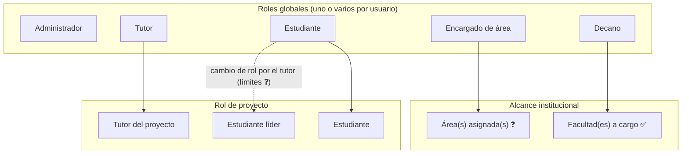

# Roles y permisos

> **Estado:** definición funcional. Es una **matriz conceptual**: no constituye un sistema de autorización ni se ha implementado. Los roles globales y de proyecto sí existen en el modelo de datos (`user_roles`, `project_members`).
> **No inventes permisos.** Lo que no aparece como ✅ requiere confirmación antes de implementarse.
> Marcas: ✅ confirmado · 🟡 hipótesis · ❓ pendiente · `—` no definido. Los códigos `P-xx` remiten a las [preguntas pendientes](business-rules.md#preguntas-pendientes).

- **Auth.js** es el mecanismo de autenticación y autorización.
- **Un usuario puede tener varios roles globales** y sus permisos se **suman** (P-02, DB-01). Ejemplo: un docente que es Tutor y Decano tiene los permisos de ambos, cada uno con su propio alcance.
- Cualquier permiso nuevo debe registrarse en este documento.
- Si la definición afecta la arquitectura, registra además un ADR en `docs/decisions/`.

## 1. Tipos de alcance

Los permisos se definen en tres niveles. Distinguirlos evita conflictos:

| Nivel | Qué determina | Ejemplo |
| --- | --- | --- |
| **Rol global** | Qué puede hacer el usuario en el sistema | Un Administrador crea usuarios. |
| **Responsabilidad en facultad o área** | Sobre qué subconjunto institucional actúa | Un Decano gestiona los proyectos **de sus facultades**. |
| **Rol de proyecto** | Qué puede hacer dentro de un proyecto concreto | Un Tutor crea tareas **en sus proyectos**. |

> ✅ **P-03:** el *estudiante líder* es un **rol de proyecto**, no un rol global (`project_role = STUDENT_LEADER`). Hay como máximo **un líder activo por proyecto**. Los roles globales son Administrador, Encargado de área, Decano, Tutor y Estudiante. Los límites del tutor al cambiar el rol de un estudiante siguen pendientes (P-21).

## 2. Definición de roles

### Administrador
- **Alcance:** todo el sistema.
- ✅ Modificar roles.
- ✅ Crear usuarios con roles preestablecidos.
- ✅ Consultar métricas generales mediante dashboards.
- ❓ No está definido si tiene acceso operativo sobre proyectos, tableros o novedades (P-22).

### Encargado de área
- **Alcance:** áreas como investigación, semilleros o proyectos de grado. Falta definir si son solo las asignadas o todas (P-08).
- ✅ Administrar la información relacionada con las áreas.
- ✅ Crear anuncios generales (novedades) dirigidos a determinados roles o a todos los usuarios.
- ✅ Consultar métricas mediante dashboards. El alcance de las métricas está pendiente.
- 🟡 Publicar novedades dirigidas a su área.

### Decano
- **Alcance:** una o varias facultades a su cargo ✅.
- ✅ Crear, modificar y eliminar proyectos. 🟡 Se supone que solo en sus facultades.
- ✅ Asignar tutores responsables a los proyectos.
- ✅ Enviar notificaciones (P-16).
- ✅ Publicar información general dirigida a sus facultades o a proyectos específicos. 🟡 Se supone que solo proyectos de sus facultades.
- ✅ Consultar información y métricas de sus facultades.

### Tutor
- **Alcance:** uno o varios proyectos a su cargo ✅.
- ✅ Crear tareas, reuniones y recordatorios. Falta confirmar si "tarea" es una actividad o un tablero (P-09).
- ✅ Cambiar el rol de los estudiantes **dentro de los límites de sus permisos** (P-21).
- ✅ Aprobar actividades. Se deduce del atributo "estado de aprobación por parte del tutor".
- ✅ Consultar información y métricas de sus proyectos.

### Estudiante líder de grupo
- **Alcance:** su proyecto (rol de proyecto, máximo uno por proyecto) y las actividades que tiene asignadas.
- ✅ Interactuar con las actividades que tiene asignadas (P-13).
- ✅ Crear, modificar y eliminar **encargados** de otras actividades, según los permisos establecidos (P-10).
- ✅ Consultar la información de su proyecto mediante un dashboard.

### Estudiante
- **Alcance:** las actividades que tiene asignadas y su proyecto.
- ✅ Interactuar con las actividades que tiene asignadas (P-13).
- ✅ Consultar la información de su proyecto mediante un dashboard.

## 3. Matriz conceptual de permisos

Leyenda: **C** crear · **R** consultar · **U** modificar · **D** eliminar · **A** aprobar · **I** interactuar.
Una celda sin marca de estado está ✅ confirmada. Las celdas `—` no tienen permiso definido, **lo que no equivale a una denegación confirmada**.

| Recurso | Administrador | Encargado de área | Decano | Tutor | Estudiante líder | Estudiante |
| --- | --- | --- | --- | --- | --- | --- |
| Usuarios | C | — | — | — | — | — |
| Roles globales | U | — | — | — | — | — |
| Rol de estudiante en proyecto (incluye líder, máx. uno) | U ❓ | — | — | U (limitado, P-21) | — | — |
| Áreas | — ❓ | R U (C D ❓) | — | — | — | — |
| Facultades | — ❓ | — | R (sus facultades) | — | — | — |
| Proyectos | — ❓ | — ❓ | C R U D (sus facultades 🟡) | R (sus proyectos) | R (su proyecto) | R (su proyecto) |
| Asignación de tutor a proyecto | — ❓ | — | C (U D 🟡) | — | — | — |
| Tableros | — | — | — | C ❓ (P-09) | — | — |
| Actividades | — | — | — | C ❓ · A | I (asignadas) | I (asignadas) |
| Encargados de actividad | — | — | — | — ❓ | C U D | — |
| Reuniones | — | — | — | C | R 🟡 (si es participante) | R 🟡 (si es participante) |
| Recordatorios | — | — | — | C | — | — |
| Documentos | — | — | — | — ❓ | — ❓ | — ❓ |
| Novedades | — ❓ | C (todos / roles; área 🟡) | C (sus facultades / proyectos) | — | — | — |
| Notificaciones | — | — | C (P-16) | — | — | — |
| Lectura de novedades | R 🟡 (audiencia) | R 🟡 | R 🟡 | R 🟡 | R 🟡 | R 🟡 |
| Dashboard | R (general) | R (alcance ❓) | R (sus facultades) | R (sus proyectos) | R (su proyecto) | R (su proyecto) |

## 4. Restricciones conocidas

- ✅ El alcance del decano se limita a **sus facultades** en información y métricas.
- ✅ El alcance del tutor se limita a **sus proyectos** en información y métricas.
- ✅ Estudiantes y líderes solo interactúan con las actividades **que tienen asignadas**.
- ✅ El tutor cambia roles de estudiantes **dentro de los límites de sus permisos**, que aún no están definidos.
- ✅ Los cambios del líder sobre encargados ocurren **según los permisos establecidos**, que aún no están definidos.
- ✅ Web y móvil nunca aplican permisos por su cuenta; los aplica el backend (ver `AGENTS.md`).

## 5. Conflictos y aspectos por confirmar

| # | Conflicto o ambigüedad | Impacto |
| --- | --- | --- |
| 1 | **Administrador y Tutor modifican roles.** Hay que delimitar si el tutor cambia solo roles de proyecto (Estudiante ↔ Líder) y el administrador solo roles globales. | Alto: riesgo de escalada de privilegios. |
| 2 | **Encargado de área y Decano** pueden administrar proyectos que coinciden (un proyecto pertenece a un área y a una o varias facultades; en proyectos interfacultad actúan varios decanos). Falta definir quién tiene precedencia. | Alto |
| 3 | **Estudiante líder: "encargados de otras actividades".** No está claro si son actividades distintas a las suyas, cualquier actividad del proyecto o solo las de su tablero. | Medio |
| 4 | **Tablero con "estudiante encargado"** frente al **estudiante líder**: no está claro si son la misma figura (P-24 parcial: el tablero tiene un solo estudiante encargado; el líder es un rol de proyecto único). | Medio |
| 5 | **Quién crea tableros y actividades.** Actividad tiene "autor", así que podría crearla cualquier participante. El texto solo dice "Tutor: crear tareas". | Alto para el diseño de permisos |
| 6 | **Qué tutor aprueba:** el tutor responsable del tablero o cualquier tutor del proyecto. | Medio |
| 7 | **Decano enviando notificaciones** frente a **novedades**: puede ser el mismo concepto. | Medio |
| 8 | **Permisos sobre documentos:** no hay ninguno definido. | Alto: bloquea el módulo de documentos |
| 9 | **Usuario con varios roles.** ✅ Parcialmente resuelto (P-02): se permiten varios roles globales y los permisos se suman. Falta definir qué ocurre cuando los alcances se cruzan (p. ej. un decano que además es tutor de un proyecto de su facultad) y si hay incompatibilidades entre roles. | Medio |
| 10 | **Eliminación de proyectos** por el decano: la eliminación es lógica (P-20). Falta definir quién puede restaurar y la visibilidad de los dependientes. | Medio |

El detalle de cada pregunta está en [`business-rules.md`](business-rules.md#preguntas-pendientes).
