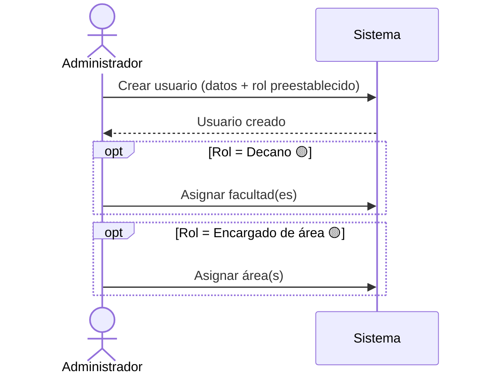
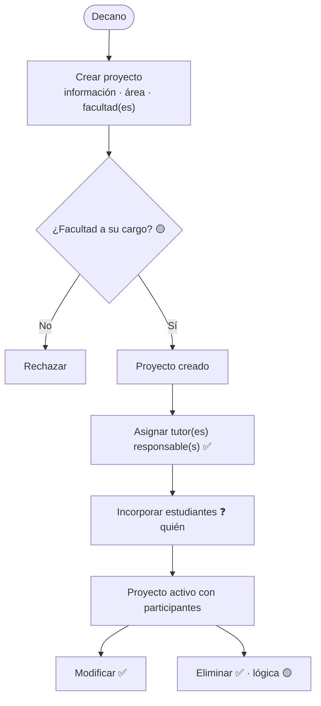
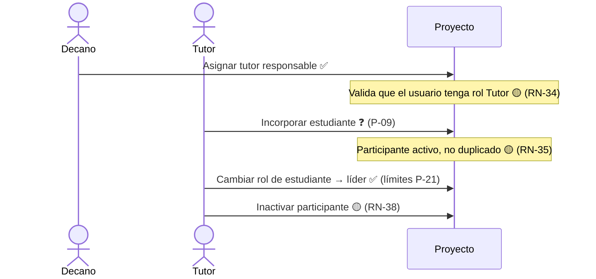
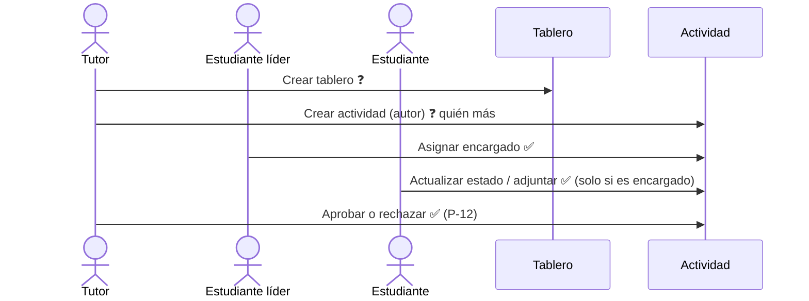
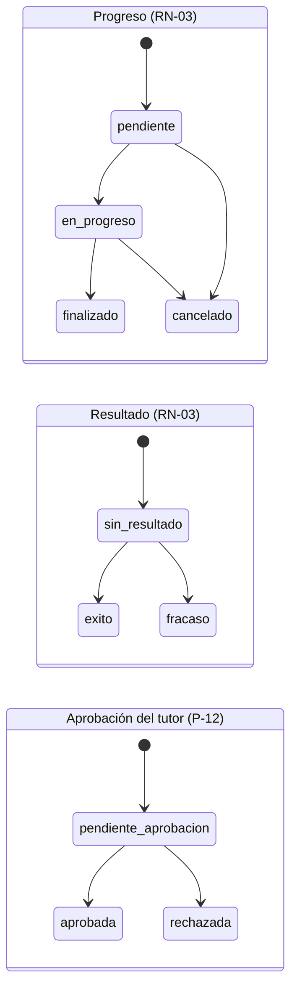
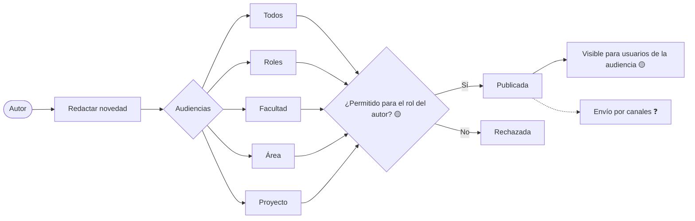
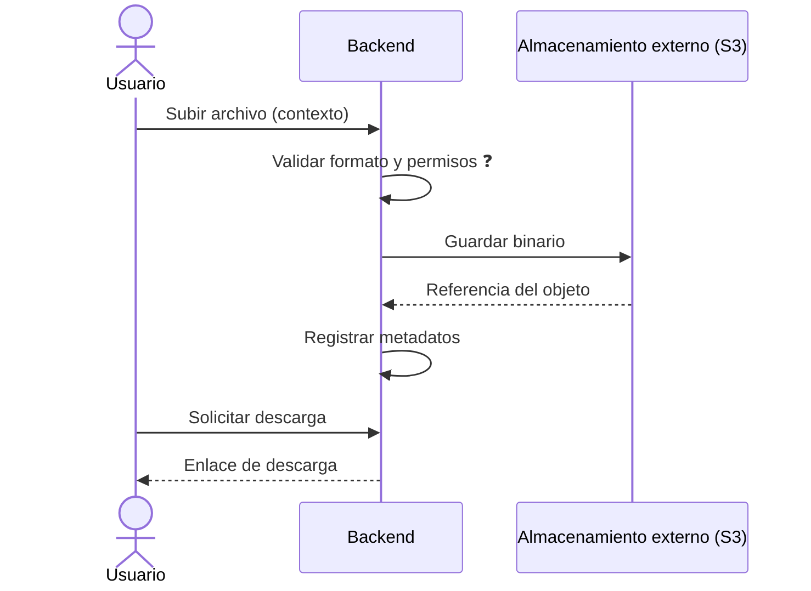
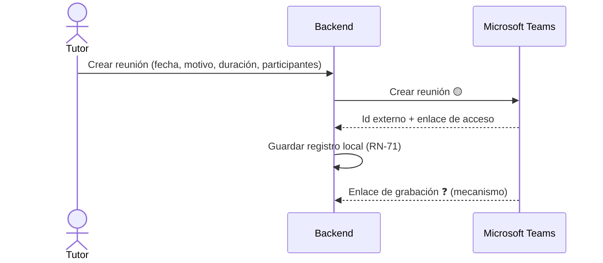

# Flujos principales

> **Estado:** planificación. Son flujos **conceptuales** e independientes de la interfaz y de la API.
> Marcas: ✅ confirmado · 🟡 hipótesis · ❓ pendiente. Los pasos marcados 🟡/❓ no deben implementarse sin confirmación.
> Las reglas citadas (`RN-xx`) y las preguntas (`P-xx`) están en [`business-rules.md`](business-rules.md).

## 1. Alta de usuarios y roles

1. ✅ El **Administrador** crea el usuario con un rol preestablecido (RN-10).
2. 🟡 Si el rol es *Decano*, se le asignan una o varias facultades. Si es *Encargado de área*, se le asignan áreas (P-08).
3. ✅ El Administrador puede modificar roles más adelante.
4. 🟡 El acceso se valida con Auth.js. El flujo de sesión está pendiente (ver `AGENTS.md` §4).

## 2. Creación y administración de proyectos

1. ✅ El **Decano** crea un proyecto y registra su información.
2. ✅ Selecciona el **área** (tipo) y **una o varias facultades**; 🟡 al menos una de ellas debe estar a su cargo (RN-22, RN-23, P-04).
3. ✅ Asigna uno o varios **tutores responsables** y marca a uno como **principal** (RN-31, P-05).
4. 🟡 Se incorporan los estudiantes. Falta definir si lo hace el tutor o el decano (P-09).
5. ✅ El Decano puede modificar o eliminar el proyecto. ✅ La eliminación es lógica (P-20).

## 3. Asignación de tutores y estudiantes

- El vínculo usuario–proyecto se registra como **participante de proyecto**, con su rol de proyecto y su estado.
- Al salir del proyecto, el participante se **inactiva** en lugar de borrarse, para conservar autoría y aprobaciones (🟡).

## 4. Gestión de tableros y actividades

### 4.1 Flujo de trabajo

1. ❓ Un tutor (probablemente) crea un **tablero** con título, fecha de entrega, tutor responsable y estudiante encargado (P-09, P-24).
2. ✅ Se crean **actividades** dentro del tablero. Cada una registra a su autor.
3. ✅ El **estudiante líder** asigna, cambia o quita los **encargados** de las actividades (RN-47).
4. ✅ Los encargados **interactúan** con sus actividades y actualizan el estado o adjuntan un enlace o documento (P-13).
5. ✅ Un **tutor** registra el estado de aprobación (RN-49).

### 4.2 Estados de la actividad (propuesta)

🟡 La actividad combina **tres dimensiones independientes**. Así se respeta RN-02 y RN-04 sin mezclar progreso, resultado y aprobación:

> Los valores están confirmados (P-11, P-12) y se aplican también al tablero. Las **transiciones** son ilustrativas y no están confirmadas (RN-49a).

## 5. Publicación de novedades

1. ✅ Un **Encargado de área** o un **Decano** redacta una novedad.
2. ✅ Elige una o varias audiencias permitidas por su rol (RN-51, RN-52).
3. 🟡 El sistema valida que el autor pueda publicar en cada audiencia.
4. 🟡 Los usuarios ven la novedad si pertenecen a alguna de sus audiencias (RN-53, RN-54).
5. ✅ No se registra la lectura y la notificación es un tipo de novedad (P-16).
6. ✅ Se envía una copia por correo o WhatsApp a cada destinatario (menos el autor) según sus preferencias por tipo y canal (RN-89 a RN-91). Los envíos fallidos se reintentan ([ADR 0005](../decisions/0005-notificaciones-y-copias-externas.md)).

| Autor | Audiencias permitidas |
| --- | --- |
| Encargado de área | Todos ✅ · Roles ✅ · Área 🟡 |
| Decano | Sus facultades ✅ · Proyectos específicos ✅ (de sus facultades 🟡) |
| Otros roles | ❓ (P-17) |

## 6. Gestión documental

1. 🟡 Un usuario autorizado (❓ quién, P-15) solicita subir un archivo.
2. ✅ El backend valida el formato (PDF, Word, Excel o imagen) y lo guarda en el almacenamiento externo.
3. ✅ El sistema registra los **metadatos** y la clave del objeto en S3 (DB-08).
4. ✅ El documento pertenece a un proyecto y puede adjuntarse a una o varias actividades (P-14, P-15).
5. ✅ Para descargarlo, el backend entrega el enlace de descarga. Los clientes nunca acceden al almacenamiento directamente.

## 7. Gestión de reuniones

1. ✅ El **Tutor** crea una reunión con fecha, motivo, duración y participantes.
2. ✅ El backend crea la reunión en el calendario de **Microsoft Teams** de la cuenta vinculada del tutor y guarda el identificador externo y el enlace de acceso; si no puede, no la crea (RN-75).
   - ✅ Envía la invitación con el enlace y programa recordatorios 24 h y 1 h antes (RN-78).
3. ✅ Localmente solo se guarda lo indicado en RN-71.
4. ✅ El estado avanza solo por horario o a mano (RN-77) y el organizador registra, si existe, el enlace de evidencia de la grabación (RN-79).
5. ❓ La sincronización de cambios hechos en Teams está por definir (P-18).

## 8. Recordatorios

✅ El tutor crea recordatorios. Los atributos, destinatarios y canales están por definir (P-19).
